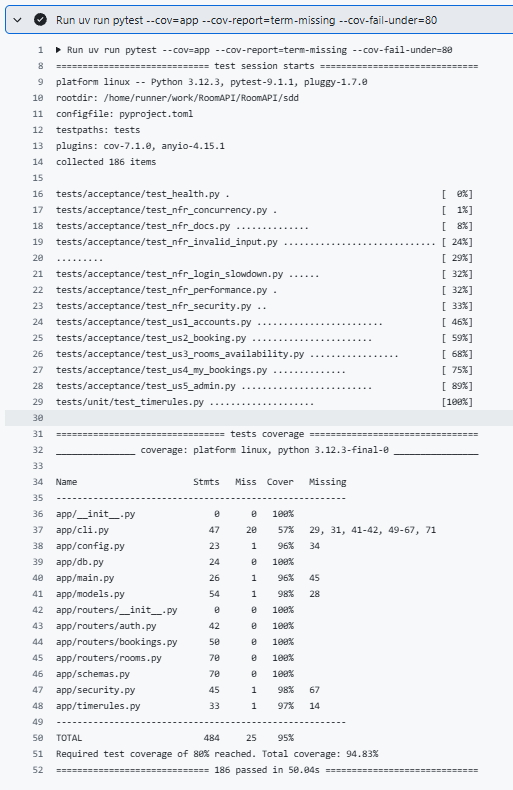

# An Experience Report on a Specification-Driven, AI-Assisted Software Construction Project

## Team Details

| Student Name | Student ID | Role in the project | Contribution (%) |
|---|---|---|---|
| Ivar Lehvonen | 2202699 | Prompt Engineer | 50% |
| Kristoffer Elfving-Millan | 2201244 | Code Auditor | 50% |

## Executive Summary

Our system is a RoomAPI, a REST API for booking meeting/study rooms like what we have in Aurum, although we do not have any rooms to actually book.
We buit the API twice, first version was a fully vibecoded version where even the AI wrote the prompts, we wanted to fully embody the vibe coding aspect.
The second version was done with Specification-Driven Development (SDD).

For the SDD version we used GitHub Spec Kit together with Claude Code, and the AI model behind both versions was Claude Opus 5.5 on medium effort.
Spec Kit gave us a fixed workflow to follow: constitution, specify, clarify, plan, tasks and implement.
The specification was written as user stories with Given/When/Then acceptance scenarios, 17 numbered functional requirements, 9 non-functional requirements, a data model and an API contract.
The clarify step was where we actually had to make decisions, things like how far ahead you can book and what happens after too many failed logins.
The implementation was then split into 37 tasks, which we merged in six pull requests.

To check that the AI-generated code really does what the spec says, every requirement is mapped to at least one test in a traceability matrix.
The SDD version passes all 186 tests with 94.8% code coverage, and we also broke the code on purpose in two places to make sure the tests notice it.
Finally we ran the same tests against both versions. The SDD version passed 155 out of 155 and the vibe version 114 (out of the 166 tests only 155 of them could run over HTTP against both, the other 11 need the test database witch the vibecoded version does not have).
None of the vibe version's failures were crashes; it simply made its own choices where our spec had decided something else.


## 1. Introduction & Paradigm Shift (3 Points)

### 1.1 Project Overview & Objectives

The idea was to build the same system twice, once by vibe coding and once with Specification-Driven Development (SDD), and then compare the two.

The system we chose is RoomAPI, a REST API for booking meeting/study rooms.
Users can register, log in, see the list of rooms, check when a room is free, book it, and see and cancel their own bookings.
Admins can create, edit and deactivate rooms and cancel any booking.
The most important rule is that two bookings for the same room can never overlap.

We kept the scope to the API only, so there is no front end and nothing is hosted. Both versions are written in Python with FastAPI and SQLite.

Our objectives were to get a working API out of both methods, to keep the comparison fair by giving both versions the same features and running the same tests on both, and to be able to trace every requirement to a test.
We also wanted every prompt logged in Git, so that anyone can see what the AI was asked and what it produced (docs\sdd\prompt-log.md, docs\vibe\prompt-log.md).


### 1.2 The Vibe Coding

Our approach to the vibecoded version was to atleast try to have the same functional features as we would have in the SSD version so that they could be compared to each other.
We used Claude Code with Opus 5.5 on medium effort, working only in vibe/.

#### Round 1
The first promt was written by us. The prompt was a short feature list with no rules or limits, except for the vibe/ constraint. We wanted to show and also see for our self the choices that the AI would make. 
After that we probed the API and found 4 bugs and 5 rules the agent had chosen without asking.

#### Round 2
The problems were described as plain symptoms, without saying how to fix them. We decided to have another agent write the prompts to a fresh agent that we read and approved.
No AI generated promt was edited for the vibe version, because we wanted to see how capable the AI realy was. In retrospect it would have been interesting to experiment with different models and effort levels.

After Round 2 we frozze vibe/ at b68a979 to serve as the baseline. The full prompts, outputs and iteration log are in the vibe prompt log (docs\vibe\prompt-log.md).

### 1.3 The SDD Methodology

#### Tool

For the SDD version we used GitHub Spec Kit together with Claude Code, with the same model and effort level as the vibe version, Opus 5.5 on medium effort.
Spec Kit was the tool named for the course, and it works directly inside Claude Code, which we were already using.
Keeping the same agent and model also made the comparison fairer, since the only thing that changed was the method.

#### Approach

We started by writing a constitution with five principles: Specification First, Test-First, Secure by Default, Explicit Time Handling and Simplicity (sdd.specify\memory\constitution.md).
After that we followed the Spec Kit steps: specify, clarify, plan, tasks and implement.
The clarify step was the biggest difference to the vibe version. This time we decided the rules ourselves instead of letting the AI pick them. For example, bookings are only allowed 08:00–18:00, at most 4 hours long, and can't be edited.
The specification ended up with 17 functional and 9 non-functional requirements, which are described in section 2 (sdd\specs\001-room-booking-api\spec.md).

#### Timeline

On 13 October we set up the repository and ran the first vibe round.
On 16 October we probed the vibe API, ran round 2 and froze it. The same day we wrote the whole SDD specification, from constitution to tasks, and implemented the 37 tasks in six pull requests.
The specification itself took around ten minutes, which surprised us. In retrospect we should have spent more time reading what the AI produced before moving on to the next step.
This fast timeline was requiered due to group members different schedules and time left over from work and other courses.

## 2. Requirements & System Specification (6 points)

<!-- The "source of truth" constructed to feed into the AI. Most critical section. -->

### 2.1 Stakeholders

<!-- The stakeholders and why they were chosen. -->

### 2.2 Functional Requirements

<!-- What functional requirements are, then this project's functional requirements. -->

### 2.3 Non-Functional Requirements

<!-- What non-functional requirements are, then this project's (performance, security, usability, reliability constraints). -->

### 2.4 Technology Stack

<!-- The stack and the reasons for choosing it. -->

AI Generation & Orchestration Tools: TODO

### 2.5 Interface & API Specifications

<!-- The API the system exposes: endpoints, methods, who may call them, request and response schemas, status codes.
The exported OpenAPI spec goes in docs/. -->

### 2.6 How these requirements and specifications were created (using SDD AI tools)

<!-- How the SDD AI tools (Spec Kit + coding agent) were used to produce the requirements and specifications above. -->

## 3. Vibe coding and your project (5 pts)

The Git history shows Ivar as the author for all of the code and prompt commits. This is because Ivar was the only person that had access to Claude Code, so every prompt had to run trough his account. 
Instead of "faking" the Git history by loging in on Kristofers GitHub account on Ivars computer to achive a 50/50 commit split on the coding we decided to not try and deceive anyone and instead mention it in the report.
The work itself was done together. Every step, from reading/writing the prompts to reading the output and probing the API, was done over Discord while screen sharing on, and all of the decisions were made by both of us.
Kristoffers part as the Code Auditor shows up in Git history and merges, all though we both shared that work aswell, we split the workload 50/50 and did not read the same files (except for when we did by accident).
We decided at PR #22 that maybe we should have Kristoffer merge the PRs just so that he wouldnt be 100% excluded from the Git history in the coding part of the project.

### 3.1 Prompting Framework

We didnt use any specific prompting technique like chain-of-thought or few-shot examples, and we didnt give the AI a system prompt or a role. This was done on purpose.
Claude Code is an agentic tool, so a single prompt was enough to build the whole API. The agent planned the work, wrote the files, installed the packages, wrote its own tests and ran them without us asking it to.

#### Round 1
The first prompt was zero-shot, a plain feature list in normal language. The only things we added were a boundary (only read and write filles inside vibe/) and asking it to tell us how to run it.

#### Round 2
The second prompt was written like a bug report. Every problem was one bullet describing the symptom, not how to fix it. 
Where a rule was missing, the prompt only said that there should be one ("There should be a max booking length and opening hours"), so the agent had to choose the limits itself.
The prompt was drafted by the Claude Code session that had probed the API, and then sent to a fresh agent that had not seen anything else. That way the agent only knew what the prompt told it, like a developer getting a bug report from a tester.
We also added "do not run any git commands" so that we had time to actually read the output and commit/push when we decided to.

### 3.2 Master Prompts / System Prompts

#### Round 1

| Field | Entry |
|---|---|
| Date | 2026-10-13 |
| Who prompted | Ivar Lehvonen |
| Tool / model | Claude Code, Opus 5.5 |
| Commit | `75113b5` |
| Raw output | [`round-1-output.md`](../vibe/round-1-output.md) (terminal paste, not verbatim; see the note at its top) |
| Purpose | Get a working baseline API for the vibe-vs-SDD comparison, with no spec. |
| Reasoning for the wording | Plain feature list, the way a developer would describe it, deliberately without rules or restrictions, so the agent's own choices show. |
| Expected result | A somewhat runnable API covering partially the features, with gaps in edge cases |
| What came back | FastAPI + SQLite API in `vibe/`: register/login with JWT, list rooms, room availability, create/list/cancel bookings, admins create and edit rooms and cancel any booking, admin created via a CLI command. The agent wrote 21 tests and reported all passing. |
| Choices the agent made without being asked | Times without a timezone treated as UTC; no booking in the past; regular users can't cancel an ended booking; cancelled bookings kept with status `cancelled`; random JWT key if `ROOMAPI_SECRET_KEY` is unset. |
| Met expectations? | It ran and covered all of the features, but missed limits that wasnt specified |
| Issues (incorrect, incomplete or inefficient code) | Found afterwards by probing; none was caught by the agent's own 21 tests. 4 real bugs: 3 inputs cause an unhandled error (HTTP 500), and deactivating a room leaves its bookings active. 5 rules the prompt never specified, where the agent picked a default without asking. See §3.3 and [`docs/evidence/vibe-round-1/findings.md`](../evidence/vibe-round-1/findings.md). |
| Refinement and why | Round 2: the probe failures were turned into a loose list of symptoms, without saying how to fix them (see Round 2). |

Prompt (verbatim):

```text
Build a room booking REST API in Python with FastAPI and SQLite.

Users should be able to register and log in. Logged-in users can see a list of rooms, check when a room is available, book a room for a time slot, see their own bookings and cancel them. There should also be admin users who can create and edit rooms and cancel any booking.

Only read and write files inside the vibe/ folder. Do not touch anything outside it. Tell me how to run it.
```

#### Round 2

| Field | Entry |
|---|---|
| Date | 2026-10-16 |
| Who prompted | Claude Code, on behalf of Ivar Lehvonen, who delegated round 2. The prompt was written by the Claude Code session that ran the round-1 probe, and sent to a fresh agent that saw nothing else. Prompt and reasoning approved by Ivar Lehvonen on 2026-10-16: AI-drafted, human-approved. |
| Tool / model | Claude Code agent with fresh context (`claude-opus-5-5`) |
| Commit | `b68a979` |
| Raw output | [`round-2-output.md`](../vibe/round-2-output.md) (verbatim) |
| Purpose | Fix the 9 failures the round-1 probe found ([findings](../evidence/vibe-round-1/findings.md)). |
| Reasoning for the wording | Written the way a vibe coder reports bugs: the symptoms in plain words, one bullet per problem, with no limits, rules or design given. Where a rule was missing, the prompt only says one should exist ("There should be a max booking length and opening hours"), so the agent has to choose. The boundary sentence from round 1 is kept, plus "do not run any git commands" so commits stay with the team. |
| Expected result | All 6 symptoms fixed, with the agent choosing its own limits; existing behaviour unchanged. |
| What came back | All 6 fixed in `vibe/` only; 12 new tests, 33 in total, all passing. New settings module `app/config.py`, new dependency `tzdata`. Re-probe: the 9 round-1 failures now pass and the 5 checks that held still hold ([findings](../evidence/vibe-round-2/findings.md)). |
| Choices the agent made without being asked | Maximum booking 8 hours; bookings only 07:00–20:00 local time within one day; time zone `Europe/Helsinki`, with responses switched from UTC to local time with an offset; passwords at least 10 characters with letters plus a digit or symbol, 5 distinct characters, not the username, not a common password; lockout after 5 failures per username or 20 per IP in 15 minutes (429); deactivating a room cancels its upcoming bookings, and so does every startup, for rooms that were already inactive. |
| Met expectations? | Partly. Every symptom is fixed, but the lockout created new problems (N1, N1b), and the switch from UTC to local-time responses changes the API's output format. |
| Issues (incorrect, incomplete or inefficient code) | N1: anyone can lock a real user out for 15 minutes with 5 wrong passwords; the agent flagged this itself. N1b: 20 failures from one IP with any usernames lock out everyone behind that address (campus NAT, proxy). R1: the lockout check isn't atomic, so parallel requests get extra guesses. R2: the startup cleanup cancels bookings without recording who cancelled them. Bookings stored as UTC before round 2 are not corrected. See [findings](../evidence/vibe-round-2/findings.md). |
| Refinement and why | None. The vibe version is frozen after round 2 so it stays a baseline for the SDD comparison; N1 is kept as evidence. |

Prompt (verbatim):

```text
I tested the room booking API in vibe/ and found some problems:

- really big ids (like 2^70) in the url or in a booking give a 500 error
- a booking with a date at the very end of year 9999 also gives a 500
- if an admin deactivates a room, the bookings for that room stay active
- you can book a room for 10 years, or in the middle of the night. There should be a max booking length and opening hours
- we are in Finland. Times without a timezone get saved as UTC, so they end up 3 hours wrong
- passwords like aaaaaaaa are allowed, and you can try wrong passwords forever

Fix these. Only read and write files inside the vibe/ folder (C:\Users\lehvo\RoomAPI\vibe). Do not touch anything outside it, and do not run any git commands. Tell me what you changed and how to run it.
```

#### How the revision improved the outcome
Round 2 fixed everything we asked for. When we ran the same probe again, all 9 failures from round 1 passed, and the 5 checks that already worked still worked.
But the fixes also brought new problems. The login lockout means anyone can lock a real user out for 15 minutes with 5 wrong passwords (N1), and 20 failed logins from one IP address lock out everyone behind it (N1b). The agent also changed the API to return local time instead of UTC, which we never asked for.
So the code got better at what we pointed out, but every rule we left open was decided by the AI, and not always in a way we would have chosen.

#### Example response

Round 2, point 6 of the agent's final reply, verbatim (docs\vibe\round-2-output.md):

> 6. **Passwords and login attempts:**
>    - **New passwords** must be at least 10 characters, include letters plus a digit or symbol, use at least 5 different characters, not contain the username, and not be on a short list of common passwords. The same rules apply to `create-admin`. Existing passwords keep working.
>    - **Login lock:** 5 failed logins for one username, or 20 from one IP address, within 15 minutes lock further attempts with a 429 error that says how long to wait. A successful login resets that username's count.
>    - Locking a username also means anyone can lock a real user out for 15 minutes by guessing wrong on purpose. If the API runs behind a proxy, every request looks like it comes from the same IP, so the per-IP limit would apply to everyone together.

#### Reflection

The biggest thing we learned from the vibe version is that everything the prompt does not say, the AI decides by itself.
In round 1 we never mentioned opening hours, booking length or time zones, so the agent picked its own defaults, and its own 21 tests did not catch any of the problems we later found.
In round 2 we described the problems as symptoms, and the agent fixed them, but it also chose the rules itself, like the 8 hour limit and the lockout. Some of those choices were worse than the bugs they fixed.
To get the result we actually wanted, the prompt would have needed the decisions made beforehand: what the limits are, how logins should be protected and what format times are returned in. At that point the prompt starts to look like a specification, which is exactly what we did in the SDD version.

### 3.3 Prompt Iteration Log

| Initial Prompt/Specification | AI Failure Mode / Bug Produced | Refined Prompt/Specification | Resulting Code Quality | What did not happen according to your plan | Modified Prompt |
|---|---|---|---|---|---|
| Round 1 prompt (§3.2) | Bug: huge IDs (2^70) in a path or body cause an unhandled error, HTTP 500 (probe P4a, P4b) | "really big ids (like 2^70) in the url or in a booking give a 500 error" | Fixed: IDs limited to 1…2^63−1, now 422 | Nothing: fixed as asked | Round 2 (§3.2): the failure described as a symptom, no fix specified |
| Round 1 prompt (§3.2) | Bug: a booking near year 9999 overflows during the UTC conversion and causes an unhandled error, HTTP 500 (probe P5) | "a booking with a date at the very end of year 9999 also gives a 500" | Fixed: out-of-range dates now 422 | Nothing: fixed as asked | Round 2 (§3.2): the failure described as a symptom |
| Round 1 prompt (§3.2) | Bug: deactivating a room leaves its future bookings active, while the owner can no longer see the room (probe P3) | "if an admin deactivates a room, the bookings for that room stay active" | Fixed: deactivation cancels upcoming bookings in the same step | The agent also chose, unasked, to cancel bookings in already-inactive rooms at every startup | Round 2 (§3.2): the failure described as a symptom |
| Round 1 prompt (§3.2) | Unspecified in the prompt → agent chose no maximum booking length and no opening hours: one user can book a room for 10 years, or at 03:00 (probe P1, P2) | "you can book a room for 10 years, or in the middle of the night. There should be a max booking length and opening hours" | Fixed, with limits the agent chose itself: at most 8 hours, 07:00–20:00 local time | The limits were never agreed by the team; the agent chose them | Round 2 (§3.2): said a rule should exist, without saying what it is |
| Round 1 prompt (§3.2) | Unspecified in the prompt → agent chose to read times without an offset as UTC, so Helsinki summer times (UTC+3) are stored 3 hours off (probe P6) | "we are in Finland. Times without a timezone get saved as UTC, so they end up 3 hours wrong" | Fixed: naive times read as `Europe/Helsinki` | Responses changed from UTC to local time with an offset, an unrequested API format change; bookings stored before round 2 are not corrected | Round 2 (§3.2): the failure described as a symptom, with the location |
| Round 1 prompt (§3.2) | Unspecified in the prompt → agent chose length ≥ 8 as the only password rule and no limit on failed logins (probe P7, P8) | "passwords like aaaaaaaa are allowed, and you can try wrong passwords forever" | Fixed: stronger password rules; lockout after 5 failures (429) | New problems: anyone can lock a real user out for 15 minutes (N1), and 20 failures from one IP lock out everyone behind it (N1b); not fixed, vibe frozen | Round 2 (§3.2): the failure described as a symptom |

(docs\vibe\prompt-log.md).

## 4. Specification Driven Development and Your Project (7 pts)

### 4.1 SDD Tool-kit

<!-- The toolkit (Spec Kit) and the reason for choosing it. -->

### 4.2 Development Environment

<!-- System environment and IDE/coding agents used, and why. -->

### 4.3 Deriving the requirements using the IDE/coding agents

<!-- How FRs and NFRs were derived with the toolkit and IDE, including the prompts. Possible activities:
SRS, system constraints, interfaces, acceptance criteria, compliance requirements. -->

### 4.4 SDD Workflow and Implementation

<!-- Which workflow was used. Any existing workflow can be adopted, or propose the team's own. -->

### 4.5 Prompts

<!-- Same as 3.2, for SDD (source: docs/sdd/prompt-log.md). -->

## 5. Verification and Validation (6 pts)

### 5.1 V&V Strategy

We verified the AI-generated code with test-driven development, a human in the loop and evidence that the tests themselves work. The AI wrote both the code and the tests, so we could not simply trust a green test run. Every layer below exists to check the layer before it.

**1. Tests written from the specification, before the code.** For each user story the agent first wrote acceptance tests from the spec's acceptance criteria, ran them, and committed them while they failed. Only then did it write the implementation (see 4.4). This way the tests describe what the spec asks for, not what the code happens to do, and the Git history proves the order.

**2. Test levels.**

| Level | What | Where |
|---|---|---|
| Unit tests | The booking time rules on their own: opening hours, the 4-hour limit, the 90-day horizon, summer and winter time, out-of-range dates (19 tests) | `sdd/tests/unit/` |
| Functional / acceptance tests | Every user story's scenarios through the HTTP API, black-box (one file per story) | `sdd/tests/acceptance/test_us*.py` |
| Non-functional tests | Security, invalid input, simultaneous bookings, performance with 1,000 bookings, documentation, login slow-down | `sdd/tests/acceptance/test_nfr_*.py` |
| Requirement verification | A traceability table that maps every FR, NFR and success criterion to the tests that cover it; none is left without a test | `sdd/specs/001-room-booking-api/traceability.md` |
| Regression and coverage | GitHub Actions runs all tests on every pull request and fails below 80% coverage | `.github/workflows/sdd-tests.yml` |

**3. AI-assisted review.** Every pull request was reviewed before merge. We used an AI (Claude Code) to conduct the code reviews: it checked out each pull request, ran the tests commit by commit, checked the tests against the spec and then the code, and tried extra edge cases. We read each review and decided whether to merge. What the reviews found went into the next prompt (see 4.4).

**4. Checking the tests.** A test that passes may pass for the wrong reason. We used three checks:

- **Mutation checks.** For the two most important tests we broke the code on purpose and checked that the tests failed (tables below).
- **Failing first.** Tests had to fail before the code existed. This caught tests that passed for the wrong reason (see the audit log, 5.2).
- **Testing the other version.** The acceptance tests are black-box, so we ran them unchanged against the vibe version too (5.3). They found real differences there, which shows they test behaviour rather than our implementation.

**Threats to validity.**

- **The same AI wrote the code and the tests.** Both come from one model reading one spec, so they can share a misunderstanding. Our review and the mutation checks reduce this risk but don't remove it.
- **The tests are only as good as the spec.** Something the spec doesn't mention is not tested. The traceability table shows that every requirement is covered, not that the requirements are complete.
- **11 tests can't run against an external server**, because they read or write the test database directly. They run in-process only, so the vibe comparison is based on 155 tests, not 186.
- **The vibe comparison isn't purely about correctness.** 17 of vibe's 41 failures are interface differences (other paths or formats for the same feature), and 11 are missing documentation. Only the remaining 13 are behaviour the spec decided differently.
- **Small scale.** Everything ran on one machine with SQLite and one process. The performance test (1,000 bookings) and the 20-request concurrency test say nothing about many servers or much larger data.
- **Timing tests depend on the machine.** The performance and slow-down tests measure time, so a much slower or busier machine could give different results.
- **No real users.** We did no user acceptance testing with real employees or administrators; the acceptance tests stand in for them.

**Mutation checks.** The test `sdd/tests/acceptance/test_nfr_concurrency.py` catches double-booking. Without the `BEGIN IMMEDIATE` write lock (research R1), 20 simultaneous requests for one free slot created up to 10 bookings. With it, exactly 1.

Run on 2026-10-16 on branch `feat/sdd-bookings` (#18). For the check, the line `connection.exec_driver_sql("BEGIN IMMEDIATE")` in `sdd/app/db.py` was temporarily replaced with `pass`, then restored with `git checkout -- app/db.py`. Nothing from the mutated version was committed.

| Run | Write lock | Bookings created for the same slot | Test |
|---|---|---|---|
| 1 | removed | 10 | failed (`assert 10 == 1`) |
| 2 | removed | 5 | failed (`assert 5 == 1`) |
| 3 | removed | 7 | failed (`assert 7 == 1`) |
| 4 | restored | 1 | passed |

The login slow-down (NFR-009) was checked the same way, by breaking it in two ways, one at a time:

| Mutation | What it breaks | Guard test | Result |
|---|---|---|---|
| Wait while the database transaction is still open | Every other request waits behind a delayed login, so an attacker could slow everyone (vibe's N1b, in another form) | `test_a_delayed_login_does_not_block_other_requests` | failed: "bystander waited 1.78s behind the delayed login" |
| Don't clear failures after a successful login | The user stays slowed down after logging in correctly | `test_successful_login_clears_the_failures` | failed: next wrong attempt took 2.04 s (limit 1.0 s) |
| None (restored) | — | all 6 slow-down tests | passed |

### 5.2 Code Audit Log

We audited the code in three ways: a probe script that attacks the running API with chosen inputs (vibe rounds 1 and 2), code review of every pull request, and failing-first and mutation checks on the SDD tests. The first part of the table lists the flaws found in the vibe version and how the SDD version prevents each one. The second part lists the flaws found while building the SDD version itself.

| Issue Found | Type (security / compliance / logic) | Found by (AI / AI+human) | Resolution |
|---|---|---|---|
| **Vibe version** | | | |
| A huge ID (2^70) in a path or body crashed the server with HTTP 500 (P4a, P4b) | Security (input validation) | AI + human: probe script written by the AI, results checked and re-run by us | SDD: NFR-004 requires a client error for every invalid input. IDs are limited to 1 … 2^63−1; tests `test_huge_room_id_gives_422`, `test_cancel_huge_id_gives_422` and others |
| A booking near year 9999 overflowed and crashed the server (P5) | Security (input validation) | AI + human: probe script | SDD: the 90-day horizon is checked before any time conversion; test `test_year_9999_refused_without_overflow` |
| Deactivating a room left its bookings active but unreachable (P3) | Logic | AI + human: probe script | SDD: FR-009 refuses deactivation while bookings exist; test `test_deactivation_refused_while_future_booking_exists` |
| Unlimited login attempts (P8) | Security | AI + human: probe script | SDD: NFR-009 slow-down after 5 failures; test `test_sixth_failure_within_15_minutes_is_delayed` |
| Round 2's lockout let anyone lock a real user out, for one user (N1) or for everyone behind a shared address (N1b) | Security | AI + human: the vibe agent warned about N1; our AI-assisted review found N1b's full scope in the agent's own test | SDD: slow down, never lock (clarify answer 1, NFR-009); test `test_correct_password_still_logs_in_after_many_failures` |
| The lockout check isn't atomic, so parallel requests get extra guesses (R1) | Security (race condition) | AI + human: AI-assisted code review | SDD: accounts are never locked, so there is no lock to race. Parallel guesses each wait 2 seconds; the spec records that the slow-down limits one-at-a-time guessing only |
| A startup job cancelled bookings without recording who did it (R2) | Logic | AI + human: AI-assisted code review | SDD: no automatic cancellations; every cancellation records who made it (FR-015); test `test_admin_cancellation_records_the_admin` |
| Times without an offset were read as UTC (P6); in round 2, responses switched from UTC to local time without anyone asking | Compliance (API contract) | AI + human: probe script and our comparison of the two rounds | SDD: FR-017 rejects times without an offset and always returns UTC; tests `test_time_without_offset_refused`, `test_offset_input_returned_as_utc` |
| No limit on booking length or time of day (P1, P2) | Logic | AI + human: probe script | SDD: FR-012, 08:00–18:00 Helsinki time and at most 4 hours; test `test_booking_rules_refused_with_message` |
| Weak passwords such as `aaaaaaaa` accepted (P7) | Security | AI + human: probe script | SDD: FR-002 requires 10–128 characters; test `test_password_length` |
| **SDD version** | | | |
| NFR-006 (every request under 500 ms) contradicted NFR-009 (a deliberate 2-second delay) | Compliance (specification) | AI: the clarify step | Fixed in the spec before planning: delayed logins are exempt from NFR-006 |
| The generated task list put the 80% coverage gate first, which would have failed CI on every pull request | Compliance (constitution: CI must pass) | AI + human: review of the task list before group A | Gate moved to the last group (T035) and a health smoke test added, before any code |
| "Not found" tests passed before the endpoint existed, because FastAPI also answers 404 for a missing route | Logic (test validity) | AI + human: the failing-first check in groups C and D | The tests now also check the error message, so they fail until the real endpoint exists |
| The first design of the slow-down waited while holding the database transaction, which would have stalled every other request | Security (denial of service) | AI + human: design review before coding | Commit before waiting; guard test `test_a_delayed_login_does_not_block_other_requests`, proven by a mutation check (5.1) |
| In external mode, the documentation test read the SDD app's own `/openapi.json` instead of the server under test, so against vibe it would have checked the wrong documentation | Logic (test validity) | AI + human: while preparing the vibe comparison run | Fixed to ask the server under test (commit `56305bb`) |

> **Note:** The findings files ([`vibe-round-1/findings.md`](../evidence/vibe-round-1/findings.md), [`vibe-round-2/findings.md`](../evidence/vibe-round-2/findings.md)) say that the probe was prompted by Ivar Lehvonen and name one of us for each review. In reality we did this work together. We worked through Ivar Lehvonen's Claude account, so the AI-written logs give the credit to the account holder alone.

The detailed probe results behind the vibe rows follow. Round 1 (commit `75113b5`):


| ID | Check | Result | Type | Severity |
|---|---|---|---|---|
| P4a | `GET /rooms/{id}` with id 2^70 | Unhandled error, HTTP 500 | Bug: input validation | High |
| P4b | `POST /bookings` with room_id 2^70 | Unhandled error, HTTP 500 | Bug: input validation | High |
| P5 | Booking on 9999-12-31 23:00 at UTC-5 (past year 9999 in UTC) | Unhandled error, HTTP 500 | Bug: input validation | Medium |
| P3 | Admin deactivates a room with future bookings | Bookings stay `active`, but the owner gets 404 on the room | Bug: logic | Medium |
| P1 | One user books one room for 10 years | Accepted | Unspecified in prompt → agent chose no maximum length | Medium |
| P8 | 50 wrong passwords, then the right one | All 401, then login succeeds | Unspecified in prompt → agent chose no lockout or delay (security) | Medium |
| P2 | Booking 03:00–04:00 | Accepted | Unspecified in prompt → agent chose no opening hours | Low |
| P6 | Time sent without an offset, meant as Helsinki summer time (UTC+3) | Stored as UTC, 3 hours off | Unspecified in prompt → agent chose to read naive times as UTC | Low |
| P7 | Register with password `aaaaaaaa` | Accepted | Unspecified in prompt → agent chose length ≥ 8 as the only rule (security) | Low |
| OK1 | Overlapping booking on the same room | Rejected, 409 | — | Holds |
| OK2 | Another user cancels someone's booking | Refused, 404 | — | Holds |
| OK3 | Booking in the past | Rejected, 422 | — | Holds |
| OK4 | End before start | Rejected, 422 | — | Holds |
| OK5 | Password storage (white-box) | Salted PBKDF2-SHA256, not plain text | — | Holds |

Severity: High = any logged-in user can cause an unhandled error with one call; Medium = wrong data or abuse possible; Low = surprising but documented or minor.

Round 2 (commit `b68a979`) fixed all nine but introduced N1 and N1b:

| ID | Check | Round 1 (`75113b5`) | Round 2 (`b68a979`) |
|---|---|---|---|
| P4a | `GET /rooms/{id}` with id 2^70 | HTTP 500 | 422, ID must be ≤ 2^63−1 |
| P4b | `POST /bookings` with room_id 2^70 | HTTP 500 | 422, ID must be ≤ 2^63−1 |
| P5 | Booking on 9999-12-31 23:00 at UTC-5 | HTTP 500 | 422, out of range |
| P3 | Admin deactivates a room with future bookings | Booking stays `active` | Booking `cancelled` in the same step |
| P1 | One user books one room for 10 years | Accepted | 422, at most 8 hours |
| P8 | 50 wrong passwords, then the right one | All 401, then success | 401 then 429; locked out |
| P2 | Booking 03:00–04:00 UTC (outside Helsinki opening hours) | Accepted | 422, only 07:00–20:00 local time |
| P6 | Time sent without an offset, meant as Helsinki local time | Read as UTC, so 3 hours off | Read as Helsinki time; still stored as UTC, but returned in local time (`+03:00` in summer, `+02:00` in winter) |
| P7 | Register with password `aaaaaaaa` | Accepted | 422, at least 10 characters |
| **N1** | **New:** an attacker sends 5 wrong passwords for alice, then alice logs in correctly | — | **429: alice is locked out** |
| **N1b** | **New:** 20 wrong logins for 20 non-existent usernames from one IP, then alice logs in correctly from the same IP | — | **429: alice is locked out.** Any shared address (campus or office NAT, a proxy) locks out everyone behind it. The agent's own test `test_login_lockout_per_ip_across_usernames` asserts exactly this. |
| OK1 | Overlapping booking | Rejected, 409 | Rejected, 409 |
| OK2 | Another user cancels someone's booking | Refused, 404 | Refused, 404 |
| OK3 | Booking in the past | Rejected, 422 | Rejected, 422 ("Cannot book a time in the past") |
| OK4 | End before start | Rejected, 422 | Rejected, 422 |
| OK5 | Password storage (white-box) | Salted PBKDF2-SHA256 | Salted PBKDF2-SHA256 |

**Found in code review (no probe check)**

| ID | Issue | Where | Type |
|---|---|---|---|
| R1 | The lockout check isn't atomic. `lockout_seconds()` runs before the failed attempt is recorded, and outside a transaction, so parallel requests can get more than 5 guesses in. Single-request tests can't show it. | `vibe/app/routers/auth.py`, `login()` | Security (race condition) |
| R2 | The startup cleanup is inconsistent with `PATCH /rooms`. It cancels bookings in inactive rooms but leaves `cancelled_by` empty, while PATCH records the admin. It also runs on every startup and changes data without anyone asking. | `vibe/app/db.py`, `init_db()` | Logic |

### 5.3 Test Execution Results

**Metrics.** The final run of the SDD version on 2026-10-16: **186 tests executed, 186 passed, 0 failed**, with **94.83% code coverage** (CI requires 80%). The only file well below 100% is `app/cli.py` (57%), the operator's command for creating admins, which the tests call directly rather than from the command line.

The table shows representative tests from each requirement area. All 186 tests and the requirements they cover are listed in [`traceability.md`](../../sdd/specs/001-room-booking-api/traceability.md).

| Test | Expected | Actual | Pass/Fail |
|---|---|---|---|
| `test_wrong_password_and_unknown_user_get_the_same_refusal` (FR-004) | Same 401 and the same message for a wrong password and an unknown user | Identical 401 responses | Pass |
| `test_password_length` (FR-002) | 9 and 129 characters refused (422); 10 and 128 accepted (201) | As expected | Pass |
| `test_stored_hash_is_salted_argon2id` (NFR-001) | Stored hashes start with `$argon2id$`, differ for the same password, and don't contain it | As expected | Pass |
| `test_overlapping_booking_refused` (FR-013) | 10:00–11:00 booked; 10:30–11:30 by another user refused with 409 and a message | 409 with a message | Pass |
| `test_back_to_back_bookings_allowed` (FR-013) | 09:00–10:00 and 11:00–12:00 next to 10:00–11:00 accepted | All three 201 | Pass |
| `test_booking_rules_refused_with_message` (FR-012) | 07:30–08:30, 17:00–18:30, 09:00–13:30 and an overnight booking refused with 422, naming the rule | 422, each naming its rule | Pass |
| `test_offset_input_returned_as_utc` (FR-017) | 09:00+03:00 stored and returned as 06:00Z | Returned in UTC with `Z`, same instant | Pass |
| `test_one_booking_splits_the_free_time` (FR-010) | With 10:00–11:00 booked, free time is 08:00–10:00 and 11:00–18:00 (in UTC) | As expected | Pass |
| `test_cancel_someone_elses_booking_forbidden` (NFR-003) | Another user's cancel refused with 403; booking still there | 403; booking unchanged | Pass |
| `test_deactivation_refused_while_future_booking_exists` (FR-009) | 409 saying "has 1 active booking"; allowed after the booking is cancelled | As expected | Pass |
| `test_huge_room_id_gives_422` (NFR-004) | `GET /rooms/2^70` gives 422, not 500 | 422 | Pass |
| `test_twenty_simultaneous_requests_create_exactly_one_booking` (NFR-005) | 20 simultaneous requests for one slot: one 201, nineteen 409 | One 201, nineteen 409 | Pass |
| `test_sixth_failure_within_15_minutes_is_delayed` (NFR-009) | After 5 failures, the 6th attempt waits at least 2 seconds | Delayed by at least 2 seconds | Pass |
| `test_correct_password_still_logs_in_after_many_failures` (NFR-009) | After 6 failures, the correct password still logs in (200) | 200, after the delay | Pass |
| `test_every_operation_under_500_ms_with_1000_bookings` (NFR-006) | Every operation under 500 ms with 1,000 bookings stored | All under 500 ms | Pass |
| `test_no_undocumented_endpoints` (NFR-007) | Every endpoint in `/openapi.json` is in the contract, and the reverse | As expected | Pass |

**CI.** The same suite ran in GitHub Actions on the final SDD pull request (#28): 186 passed, coverage 94.83% ([run](https://github.com/Lehvonen/RoomAPI/actions/runs/38898383842)).



**Defects.** No test failed in the final run. The defects found while building the SDD version are listed in the second part of the audit log (5.2). Each was fixed before its pull request was merged, so none is left open. The vibe version's failures below were deliberately not fixed: we froze the vibe version at commit `b68a979` after round 2, so that it stays an honest record of what vibe coding produced. Fixing it would have turned it into a third, partly specified version.

**Coverage per file** ([`run-in-process.txt`](../evidence/sdd/run-in-process.txt)):

```text
Name                      Stmts   Miss  Cover   Missing
-------------------------------------------------------
app\__init__.py               0      0   100%
app\cli.py                   47     20    57%   29, 31, 41-42, 49-67, 71
app\config.py                23      1    96%   34
app\db.py                    24      0   100%
app\main.py                  26      1    96%   45
app\models.py                54      1    98%   28
app\routers\__init__.py       0      0   100%
app\routers\auth.py          42      0   100%
app\routers\bookings.py      50      0   100%
app\routers\rooms.py         70      0   100%
app\schemas.py               70      0   100%
app\security.py              45      1    98%   67
app\timerules.py             33      1    97%   14
-------------------------------------------------------
TOTAL                       484     25    95%
Required test coverage of 80% reached. Total coverage: 94.83%
============================ 186 passed in 42.59s =============================
```

**The same tests against both versions.** The same black-box acceptance suite ran over HTTP against both versions on 2026-10-16: 155 tests that can run over HTTP, plus 11 that need the test database and were skipped. The SDD version passes all 155 that can run over HTTP. The vibe version (frozen at `b68a979`) passes 114 and fails 41. None of the 41 failures is a crash. 17 are interface differences, 11 are missing error documentation, and 13 are rules the vibe agent chose itself where the team's spec decided otherwise. Four of those 13 are login tests: vibe locks the account (429) instead of slowing it down, and in two of them a correct password is refused (N1).

| Run | Server | Passed | Failed | Skipped | Raw result |
|---|---|---|---|---|---|
| In-process, with coverage | SDD (`sdd/`) | 186 | 0 | 0 | [`run-in-process.txt`](../evidence/sdd/run-in-process.txt) (coverage 94.83%, gate 80%) |
| External HTTP | SDD, uvicorn | 155 | 0 | 11 | [`run-external-sdd.xml`](../evidence/sdd/run-external-sdd.xml) |
| External HTTP | vibe `b68a979`, uvicorn | 114 | 41 | 11 | [`run-external-vibe.xml`](../evidence/sdd/run-external-vibe.xml) |
| External HTTP, N1b test only | vibe, default settings | 0 | 1 | 0 | [`run-external-vibe-default-ip-limit.xml`](../evidence/sdd/run-external-vibe-default-ip-limit.xml) |

| Category | Tests | Kind |
|---|---|---|
| times returned with +03:00, not UTC Z | 5 | Interface difference |
| no GET /bookings/me (vibe lists own bookings at GET /bookings) | 4 | Interface difference |
| availability takes start/end, not date (date is ignored) | 7 | Interface difference |
| someone else's booking gives 404, not 403 | 1 | Interface difference |
| error responses not described in /openapi.json | 11 | Documentation |
| 07:00–20:00 and 8 h, not 08:00–18:00 and 4 h | 4 | Decision the spec made differently |
| no booking horizon | 1 | Decision the spec made differently |
| times without an offset read as Helsinki time | 1 | Decision the spec made differently |
| stricter passwords (5 distinct characters) | 2 | Decision the spec made differently |
| deactivation cancels bookings instead of being refused | 1 | Decision the spec made differently |
| lockout (429) instead of slow-down; a correct password refused in 2 (N1) | 4 | Decision the spec made differently |
| **Total** | **41** | |

## 6. Project Management & AI Toolchain Workflows (3 points)

### 6.1 Version Control & Prompt Integration

Git Commit Conventions:

We set up the conventions at the start of the project, before writing any code, so that the Git history would be easy to follow for both us and the course staff.
Every commit message says what kind of change it is and what it belongs to, a requirement, a prompt round or a report section, so a commit can be traced back to the spec or the report.
Not every rule was followed exactly. Most of the commits are on Ivar's account, which is explained in 6.2.

From CONTRIBUTING.md:

Format: `type(ref): description`

- `ref` is a spec ID (`FR-04`, `NFR-02`), a prompt round (`round-3`),
  a report section (`report-s5`), or `report` for a change spanning several sections
- types: feat, fix, test, docs, spec, vibe, chore

Examples:
- `vibe(round-3): add login endpoint`
- `feat(FR-04): reject overlapping bookings`
- `test(FR-04): overlap edge cases`
- `docs(report-s2): non-functional requirements`

Workflow:

- Every change goes through a pull request; no direct pushes to main
- Every PR links an issue (`Closes #12`)
- Every feature and every report section has its own issue, assigned to one member
- Discuss decisions in the issue or PR, not only in chat, so they are visible in Git
- Commit from your own GitHub account; every member opens, reviews and merges their own share of PRs
- Log every prompt in `docs/vibe/prompt-log.md` or `docs/sdd/prompt-log.md`, in the same PR as the code it produced
- Never edit `vibe/` after it is marked frozen

Every prompt we gave the AI was saved in a prompt log, docs\vibe\prompt-log.md for the vibe version and docs\sdd\prompt-log.md for the SDD version.
The prompt was committed in the same pull request as the code it produced, so the prompt and its result can always be found together.
Each log entry also says who wrote the prompt (the actuall thinking and desicion was done as a group), which model was used, what we expected and what came back.
Some prompts were drafted by the AI and then read and approved by us, and that is written in the log as well.
For the SDD version, Spec Kit split the work into six task groups (A–F).
Every group got its own issue and its own pull request (issues #16–#21, pull requests #23–#28), and commits use the requirement ID they implement, like feat(FR-013).

Workspace Configuration:

| What | Where |
|---|---|
| Claude Code, `claude-opus-5-5` | docs\vibe\prompt-log.md, docs\sdd\prompt-log.md |
| Spec Kit 1.1.4.dev0, installed as Claude Code skills: speckit-analyze, speckit-checklist, speckit-clarify, speckit-constitution, speckit-converge, speckit-implement, speckit-plan, speckit-specify, speckit-tasks, speckit-taskstoissues | sdd\.claude\skills\ |
| uv, Python 3.11 or newer | sdd\pyproject.toml, sdd\uv.lock |
| GitHub Actions workflow `sdd-tests`: on every pull request and every push to main, runs `uv sync --locked` and `uv run pytest --cov=app --cov-report=term-missing --cov-fail-under=80` in `sdd/` on Python 3.12 | .github\workflows\sdd-tests.yml |
| Pull request template (What, Spec / prompt reference, Verification, Closes #) and a Task issue template | .github\pull_request_template.md, .github\ISSUE_TEMPLATE\task.md |
| Branch protection on `main`: changes through a pull request, 1 approving review required | GitHub repository settings |

Claude Code was the only AI tool we used, and it ran on Ivar's computer and account. Spec Kit was installed into Claude Code as skills, so the SDD steps could be run as commands straight from Claude Code.
We worked together over Discord with screen sharing on, so both of us saw every prompt and every answer as it happened.
The GitHub Actions workflow ran the tests on every pull request, so a pull request with failing tests or under 80% coverage could not be missed when reviewing.

### 6.2 Team Contribution Breakdown

In a normal project most of the time would go into writing code. In this project we did not write the code ourselves, the AI did it.
Instead our time went into deciding what the system should do, writing and approving prompts, and checking what the AI produced.
Ivar's role as Prompt Engineer was to run the prompts and the Spec Kit steps. Kristoffer's role as Code Auditor was to review the pull requests and check that the code matched the spec.
The biggest shift was in the SDD version, where the clarify step made us make the decisions that the AI had made by itself in the vibe version. We went from writing code to specifying, reviewing and orchestrating the AI.

From section 3:

The Git history shows Ivar as the author for all of the code and prompt commits. This is because Ivar was the only person that had access to Claude Code, so every prompt had to run trough his account. 
Instead of "faking" the Git history by loging in on Kristofers GitHub account on Ivars computer to achive a 50/50 commit split on the coding we decided to not try and deceive anyone and instead mention it in the report.
The work itself was done together. Every step, from reading/writing the prompts to reading the output and probing the API, was done over Discord while screen sharing on, and all of the decisions were made by both of us.
Kristoffers part as the Code Auditor shows up in Git history and merges, all though we both shared that work aswell, we split the workload 50/50 and did not read the same files (except for when we did by accident).
We decided at PR #22 that maybe we should have Kristoffer merge the PRs just so that he wouldnt be 100% excluded from the Git history in the coding part of the project.

Git activity on GitHub as of 2026-10-19:

| | Ivar (@Lehvonen) | Kristoffer (@iPonkko) |
|---|---|---|
| Commits | 89 | 9 (all merge commits) |
| Pull requests opened | 16 | 0 |
| Pull requests merged | 3 | 9 |
| Pull request reviews | 0 | 11 |
| Issues assigned | 14 | 4 |

<!-- TODO (us): update the table before submitting, once Kristoffer's sections (#5, #7, #8, #10) are merged. -->

## 7. Reflections on Specification-Driven Development (5 points)

### 7.1 Benefits of AI-Assisted SDD

### 7.2 Core Bottlenecks and Challenges

### 7.3 Lessons Learned & Best Practices

<!-- Critical evaluation backed by concrete examples; evidence-based vibe coding vs SDD comparison;
successes and limitations; actionable best practices; balanced conclusion. -->

<!-- Evidence to quote in the vibe-vs-SDD comparison: in vibe round 2 the agent changed API responses
from UTC (Z) to local time (+03:00) without being asked, a contract change nobody agreed to
(docs/evidence/vibe-round-2/findings.md, "What round 2 decided on its own"). -->

### 7.4 Proposed Specification-Driven Development Workflow

<!-- A reusable workflow: each phase's objectives, activities, inputs, outputs and deliverables;
where AI/vibe coding fits and where human oversight is essential; justification from project evidence;
a process diagram. -->
