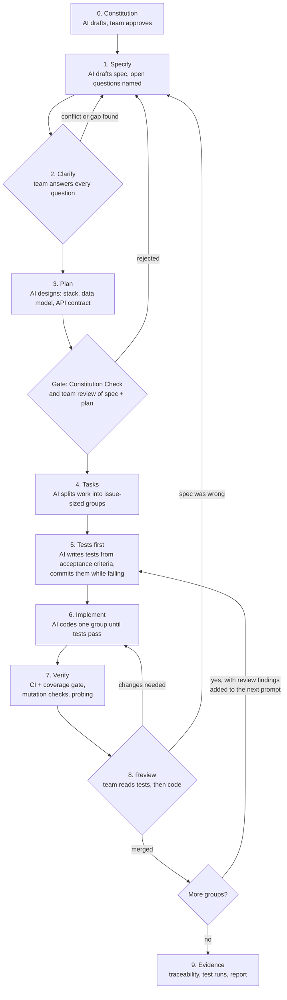

# An Experience Report on a Specification-Driven, AI-Assisted Software Construction Project

## Team Details

| Student Name | Student ID | Role in the project | Contribution (%) |
|---|---|---|---|
| Ivar Lehvonen | 2202699 | Prompt Engineer | 50% |
| Kristoffer Elfving-Milan | 2201244 | Code Auditor | 50% |

## Executive Summary

Our system is a RoomAPI, a REST API for booking meeting/study rooms like what we have in Aurum, although we do not have any rooms to actually book.
We buit the API twice, first version was a fully vibecoded version where even the AI wrote the prompts, we wanted to fully embody the vibe coding aspect.
The second version was done with Specification-Driven Development (SDD).

For the SDD version we used GitHub Spec Kit together with Claude Code, and the AI model behind both versions was Claude Opus 5.5 on medium effort.
Spec Kit gave us a fixed workflow to follow: constitution, specify, clarify, plan, tasks and implement.
The specification was written as user stories with Given/When/Then acceptance scenarios, 17 numbered functional requirements, 9 non-functional requirements, a data model and an API contract.
The clarify step was where we actually had to make decisions, things like how far ahead you can book and what happens after too many failed logins.
The implementation was then split into 37 tasks, which we merged in six pull requests.

To check that the AI-generated code really does what the spec says, every requirement is mapped to at least one test in a traceability matrix.
The SDD version passes all 186 tests with 94.8% code coverage, and we also broke the code on purpose in two places to make sure the tests notice it.
Finally we ran the same tests against both versions. The SDD version passed 155 out of 155 and the vibe version 114 (out of the 166 tests only 155 of them could run over HTTP against both, the other 11 need the test database witch the vibecoded version does not have).
None of the vibe version's failures were crashes; it simply made its own choices where our spec had decided something else.


## 1. Introduction & Paradigm Shift (3 Points)

### 1.1 Project Overview & Objectives

The idea was to build the same system twice, once by vibe coding and once with Specification-Driven Development (SDD), and then compare the two.

The system we chose is RoomAPI, a REST API for booking meeting/study rooms.
Users can register, log in, see the list of rooms, check when a room is free, book it, and see and cancel their own bookings.
Admins can create, edit and deactivate rooms and cancel any booking.
The most important rule is that two bookings for the same room can never overlap.

We kept the scope to the API only, so there is no front end and nothing is hosted. Both versions are written in Python with FastAPI and SQLite.

Our objectives were to get a working API out of both methods, to keep the comparison fair by giving both versions the same features and running the same tests on both, and to be able to trace every requirement to a test.
We also wanted every prompt logged in Git, so that anyone can see what the AI was asked and what it produced (docs\sdd\prompt-log.md, docs\vibe\prompt-log.md).


### 1.2 The Vibe Coding

Our approach to the vibecoded version was to atleast try to have the same functional features as we would have in the SSD version so that they could be compared to each other.
We used Claude Code with Opus 5.5 on medium effort, working only in vibe/.

#### Round 1
The first promt was written by us. The prompt was a short feature list with no rules or limits, except for the vibe/ constraint. We wanted to show and also see for our self the choices that the AI would make. 
After that we probed the API and found 4 bugs and 5 rules the agent had chosen without asking.

#### Round 2
The problems were described as plain symptoms, without saying how to fix them. We decided to have another agent write the prompts to a fresh agent that we read and approved.
No AI generated promt was edited for the vibe version, because we wanted to see how capable the AI realy was. In retrospect it would have been interesting to experiment with different models and effort levels.

After Round 2 we frozze vibe/ at b68a979 to serve as the baseline. The full prompts, outputs and iteration log are in the vibe prompt log (docs\vibe\prompt-log.md).

### 1.3 The SDD Methodology

#### Tool

For the SDD version we used GitHub Spec Kit together with Claude Code, with the same model and effort level as the vibe version, Opus 5.5 on medium effort.
Spec Kit was the tool named for the course, and it works directly inside Claude Code, which we were already using.
Keeping the same agent and model also made the comparison fairer, since the only thing that changed was the method.

#### Approach

We started by writing a constitution with five principles: Specification First, Test-First, Secure by Default, Explicit Time Handling and Simplicity (sdd.specify\memory\constitution.md).
After that we followed the Spec Kit steps: specify, clarify, plan, tasks and implement.
The clarify step was the biggest difference to the vibe version. This time we decided the rules ourselves instead of letting the AI pick them. For example, bookings are only allowed 08:00–18:00, at most 4 hours long, and can't be edited.
The specification ended up with 17 functional and 9 non-functional requirements, which are described in section 2 (sdd\specs\001-room-booking-api\spec.md).

#### Timeline

On 13 October we set up the repository and ran the first vibe round.
On 16 October we probed the vibe API, ran round 2 and froze it. The same day we wrote the whole SDD specification, from constitution to tasks, and implemented the 37 tasks in six pull requests.
The specification itself took around ten minutes, which surprised us. In retrospect we should have spent more time reading what the AI produced before moving on to the next step.
This fast timeline was requiered due to group members different schedules and time left over from work and other courses.

## 2. Requirements & System Specification (6 points)

### 2.1 Stakeholders

The specification is the source of truth we gave the AI agent, so it starts with the people the system serves. We asked Spec Kit's specify step to list the stakeholders and why each one matters, because its template has no stakeholder section of its own.

| Stakeholder | Interest | Why they matter |
|---|---|---|
| Employee (regular user) | Find a free room and book it quickly; trust that a booking holds | The main users. Most requirements serve their booking flow. |
| Administrator (facility manager) | Keep the room list accurate; resolve conflicts by cancelling bookings | Owns the room data. A wrong room list makes every booking wrong. |
| Operator (IT) | Run the service, create the first admin account, keep data safe | Holds the only route to admin rights, and is responsible for stored passwords. |
| Client developer | Build a front end or integration on the API | Depends on a stable, documented interface and clear errors. |
| Development team and course staff | Show that the system meets its specification | The project's evidence: every requirement must be traceable to a test. |

We chose these five groups because together they cover everyone who uses the API (employees and administrators), runs it (the operator), builds on it (client developers) or has to show that it works (our team and the course staff). Each group adds requirements the others would miss: employees drive the booking rules, administrators the room management, the operator the admin and password handling, client developers the documented interface and clear errors, and the course staff the traceability from every requirement to a test.

### 2.2 Functional Requirements

A functional requirement states what the system must do: a behaviour a user can trigger and observe, such as registering, booking a room or cancelling a booking. Each of ours is numbered (FR-001 to FR-017), written with MUST so it can be checked, and has acceptance criteria that later became automated tests. They are grouped by area: accounts, rooms, availability, bookings and time.

**Accounts**

- **FR-001**: The system MUST let anyone register an account with a username and a password. Usernames are 3–50 characters from letters, digits, `_`, `.` and `-`, and are unique regardless of letter case.
  *Acceptance*: User Story 1, scenarios 1–2.
- **FR-002**: The system MUST require passwords of 10–128 characters.
  *Acceptance*: a 9-character password is refused; a 10-character password is accepted.
- **FR-003**: The system MUST let a registered user log in with username and password and receive an access token that expires after 60 minutes. There is no logout: a token stays valid until it expires.
  *Acceptance*: User Story 1, scenario 3; a token older than 60 minutes is refused.
- **FR-004**: The system MUST give the same refusal for a wrong password and for an unknown username.
  *Acceptance*: User Story 1, scenario 4.
- **FR-005**: The system MUST let a logged-in user see their own profile (username, admin or not) and MUST NOT return any password data.
  *Acceptance*: the profile response has no password field.
- **FR-006**: Admin accounts MUST only be created by the operator, outside the public interface. Registration MUST always create regular users.
  *Acceptance*: a registration request that asks for admin rights creates a regular user.

**Rooms**

- **FR-007**: The system MUST let any logged-in user list active rooms with name, capacity and location, and look up a single active room.
  *Acceptance*: User Story 3, scenario 1.
- **FR-008**: The system MUST let admins create rooms (unique name regardless of case, capacity at least 1, optional location and description) and edit any of these fields.
  *Acceptance*: User Story 5, scenarios 1–2.
- **FR-009**: The system MUST let admins deactivate and reactivate a room. Inactive rooms MUST NOT be listed to regular users and MUST NOT accept new bookings. Deactivation MUST be refused while the room has active bookings that have not ended; the refusal says how many there are. The admin cancels them first (FR-015), so every cancellation records who made it.
  *Acceptance*: User Story 5, scenario 3; a room with one future booking cannot be deactivated until that booking is cancelled.

**Availability**

- **FR-010**: The system MUST let a logged-in user see, for one active room and one calendar date in Helsinki time, the booked and free intervals within that day's opening hours (08:00–18:00, FR-012), returned in UTC. Free intervals are exactly the times that can still be booked.
  *Acceptance*: User Story 3, scenario 2; for a day with one booking 10:00–11:00 Helsinki time, the free intervals are 08:00–10:00 and 11:00–18:00, given in UTC.

**Bookings**

- **FR-011**: The system MUST let a logged-in user book an active room for a time range whose end is after its start, whose start is not in the past, and whose start is at most 90 days from now.
  *Acceptance*: User Story 2, scenarios 1 and 4; a booking starting 91 days ahead is refused.
- **FR-012**: A booking MUST start and end within opening hours, 08:00–18:00 in the organisation's time zone (Europe/Helsinki), on the same calendar day, and MUST last at most 4 hours.
  *Acceptance*: in Helsinki time, 08:00–12:00 is accepted; 07:30–08:30, 17:00–18:30, 09:00–13:30 and 17:00 to 09:00 the next day are refused, each with a message naming the rule.
- **FR-013**: The system MUST never accept two active bookings for the same room whose time ranges overlap. Ranges include their start and exclude their end, so back-to-back bookings are allowed. This MUST hold for simultaneous requests.
  *Acceptance*: User Story 2, scenarios 2, 3 and 5.
- **FR-014**: The system MUST let a logged-in user list their own upcoming bookings, oldest first.
  *Acceptance*: User Story 4, scenario 1.
- **FR-015**: The system MUST let users cancel their own bookings that have not ended, and let admins cancel any booking. Cancelled bookings MUST be kept with their status, the time of cancellation and who cancelled them, and MUST free their slot. Cancelling someone else's booking as a regular user MUST be refused.
  *Acceptance*: User Story 4, scenarios 2–3; User Story 5, scenario 4.
- **FR-016**: Bookings MUST NOT be editable. To change a booking, the user cancels it and books again.
  *Acceptance*: no operation changes the room, start or end of an existing booking.

**Time**

- **FR-017**: Every time sent to the system MUST include a timezone offset; times without one MUST be rejected. Every time returned MUST be in UTC.
  *Acceptance*: `2026-10-20T09:00` is rejected; `2026-10-20T09:00+03:00` is accepted and returned as `2026-10-20T06:00Z`.

### 2.3 Non-Functional Requirements

A non-functional requirement states how well the system must work and under which limits, rather than what it does: its security, reliability, performance and usability. These are the areas where our vibe-coded version went wrong without anyone noticing (server errors on bad input, unlimited login attempts, times read in the wrong time zone), so we asked for them explicitly and gave each one measurable acceptance criteria (NFR-001 to NFR-009).


**Security**

- **NFR-001**: Passwords MUST be stored only as salted hashes from a slow, purpose-built password hashing algorithm, and MUST never be returned or written to logs.
  *Acceptance*: the stored value is not the password and differs between two users with the same password; no response or log line contains a password.
- **NFR-002**: Every operation except registration, login and a health check MUST require a valid access token.
  *Acceptance*: each protected operation refuses a missing, expired or tampered token.
- **NFR-003**: Every operation on a specific resource MUST check that the caller is allowed to act on it: their own booking, or any booking or room for admins.
  *Acceptance*: User Story 4, scenario 3; User Story 5, scenario 5.
- **NFR-009**: After 5 failed logins for one username within 15 minutes, each further login attempt for that username MUST be answered only after a 2-second delay, whether the password is right or not. Accounts are never locked, so nobody can lock another user out.
  *Acceptance*: the 6th attempt within 15 minutes takes at least 2 seconds; a correct password after 10 failures still logs in.

**Reliability**

- **NFR-004**: No client input may cause a server error. Every invalid request MUST get a client error with a message that says what is wrong.
  *Acceptance*: a test set of invalid inputs (huge IDs, out-of-range dates, malformed values, missing fields) produces zero server errors.
- **NFR-005**: Overlap protection (FR-013) MUST hold when booking requests for the same slot arrive at the same time.
  *Acceptance*: User Story 2, scenario 5, run with at least 20 simultaneous requests.

**Performance**

- **NFR-006**: On a developer laptop with 1,000 bookings stored, each request MUST complete in under 500 ms. Login attempts that NFR-009 deliberately delays are exempt.
  *Acceptance*: a timed test of every operation stays under 500 ms.

**Usability**

- **NFR-007**: The interface MUST be self-documenting: an interactive description of every operation, its inputs and its possible errors is available while the system runs.
  *Acceptance*: every operation and error response appears in the generated interface description.
- **NFR-008**: Error messages MUST be in plain English and name the field or rule that failed.
  *Acceptance*: each refusal in the acceptance scenarios carries such a message.

### 2.4 Technology Stack

The constitution fixed the main stack before any requirement was written, so the plan could not drift from it. The plan step then picked the remaining libraries, and its research notes (`sdd/specs/001-room-booking-api/research.md`, R1–R8) record each decision with the alternatives considered.

| Part | Choice | Why |
|---|---|---|
| Language | Python 3.11+ (3.12 used locally) | Familiar to both of us, and well supported by the AI agent and the libraries below. |
| Web framework | FastAPI with Pydantic v2 | Generates the OpenAPI description and interactive docs automatically (NFR-007). Pydantic validates every input and rejects times without an offset (FR-017, NFR-004). The vibe version also used FastAPI, so the comparison is about the process, not the framework. |
| Database | SQLite through SQLAlchemy 2 | One file and no other services (constitution principle V). A `BEGIN IMMEDIATE` transaction takes the write lock before the overlap check, so two simultaneous requests can't both book the same slot (FR-013, NFR-005). |
| Passwords | Argon2id (`argon2-cffi`) | The current OWASP recommendation; salts each hash (NFR-001). Bcrypt was rejected because it only uses the first 72 bytes and we allow passwords up to 128 characters. |
| Access tokens | JWT, HS256, 60 minutes (PyJWT) | Stateless and standard, and FastAPI's login flow gives the interactive docs a working "Authorize" button (FR-003, NFR-002). |
| Time zones | `zoneinfo` with `tzdata` | Opening hours are checked in Europe/Helsinki local time, which handles the summer and winter time changes automatically (FR-012). `tzdata` supplies the zone data on Windows. |
| Tests | pytest, pytest-cov, httpx | Black-box HTTP tests that run either in-process (with coverage) or against any running server, so the same suite could also test the vibe version (research R7). |
| Project management | uv (`pyproject.toml`, `uv.lock`) | One command installs the exact same versions locally and in CI. |
| CI | GitHub Actions | Runs the tests with the 80% coverage gate on every pull request. |

The system runs locally on one machine and in CI; nothing is deployed. It is sized for one organisation: tens of rooms, hundreds of users and thousands of bookings.

AI Generation & Orchestration Tools: Claude Code with the Claude Opus 5.5 model (`claude-opus-5-5`) as the coding agent, driven by Spec Kit 1.1.4.dev0 through its Claude Code integration. Spec Kit's slash commands (`/speckit-constitution`, `/speckit-specify`, `/speckit-clarify`, `/speckit-plan`, `/speckit-tasks`, `/speckit-implement`) orchestrated the work from specification to code.

### 2.5 Interface & API Specifications

The API contract was written in the plan step (`sdd/specs/001-room-booking-api/contracts/api.md`) before any code, and every endpoint names the requirements it serves. The running app generates the full machine-readable description at `/openapi.json`, and an interactive version, where every endpoint can be tried, at `/docs`. We exported it to [`docs/openapi.json`](../openapi.json). A test checks that every endpoint and its error responses appear in it, and that there are no undocumented endpoints (NFR-007).

The API uses HTTP and JSON. Every endpoint except register, login and health needs `Authorization: Bearer <token>` (NFR-002).

#### Conventions

- **Times**: ISO 8601 with an offset. Input without an offset → 422 (FR-017). Output is always UTC with `Z`, e.g. `2026-10-20T06:00:00Z`.
- **IDs**: integers 1 … 2^63−1. Outside that range → 422 (NFR-004).
- **Errors**: `{"detail": "<plain English message>"}`. Validation errors use FastAPI's list form, naming each failing field (NFR-008).

| Status | Meaning |
|---|---|
| 401 | missing, expired or invalid token; wrong login |
| 403 | logged in, but not allowed (not an admin, or not the booking's owner) |
| 404 | the resource doesn't exist, or the room is inactive (for regular users) |
| 409 | conflict: name taken, overlap, already cancelled, booking ended, room has bookings |
| 422 | invalid input or a broken booking rule |

#### Endpoints

| Method | Path | Who | Body / query | Success | Errors | Requirements |
|---|---|---|---|---|---|---|
| GET | `/health` | anyone | | 200 `{"status":"ok"}` | | NFR-002 (the unauthenticated health check) |
| POST | `/auth/register` | anyone | JSON `{username, password}` | 201 User | 409 name taken, 422 | FR-001, FR-002, FR-006 |
| POST | `/auth/login` | anyone | **form** `username`, `password` | 200 `{access_token, token_type:"bearer"}` | 401 | FR-003, FR-004, NFR-009 |
| GET | `/users/me` | user | | 200 User | 401 | FR-005 |
| GET | `/rooms` | user | | 200 [Room], active only, by name | 401 | FR-007 |
| GET | `/rooms/{room_id}` | user | | 200 Room | 404 (missing, or inactive for non-admins) | FR-007 |
| POST | `/rooms` | admin | JSON `{name, capacity, location?, description?}` | 201 Room | 403, 409 name taken, 422 | FR-008 |
| PATCH | `/rooms/{room_id}` | admin | JSON, any of `{name, capacity, location, description, is_active}` | 200 Room | 403, 404, 409 name taken or room has active bookings, 422 | FR-008, FR-009 |
| GET | `/rooms/{room_id}/availability` | user | query `date=YYYY-MM-DD` (Helsinki date) | 200 Availability | 404, 422 | FR-010 |
| POST | `/bookings` | user | JSON `{room_id, start_time, end_time}` | 201 Booking | 404 room, 409 overlap, 422 rule broken | FR-011, FR-012, FR-013, FR-017 |
| GET | `/bookings/me` | user | | 200 [Booking], own active bookings that haven't ended, oldest first | 401 | FR-014 |
| DELETE | `/bookings/{booking_id}` | owner or admin | | 204 | 403 not owner, 404, 409 already cancelled or ended (non-admin) | FR-015 |

There is no endpoint to edit a booking (FR-016) and none for logout (clarification 4).

#### Shapes

- **User**: `{id, username, is_admin, created_at}`. Never a password or hash (FR-005, NFR-001).
- **Room**: `{id, name, capacity, location, description, is_active, created_at, updated_at}`
- **Booking**: `{id, room_id, room_name, user_id, start_time, end_time, status, created_at, cancelled_at, cancelled_by}`
- **Availability**: `{room_id, date, opens_at, closes_at, booked: [{start, end}], free: [{start, end}]}`. All times are UTC; `opens_at` and `closes_at` are that date's 08:00 and 18:00 in Helsinki.

### 2.6 How these requirements and specifications were created (using SDD AI tools)

We created the requirements and specifications with Spec Kit and Claude Code in four steps, all on 2026-10-16. Every step produced a Markdown file, and we reviewed all of them together in one pull request (#22) before any code was written.

1. **Constitution** (`/speckit-constitution`): the project's fixed rules, before any requirement existed: specification first, tests first, secure by default, explicit time handling and simplicity. The first four each answer a problem we had found in the vibe version.
2. **Specify** (`/speckit-specify`): the prompt below. It asked for the same features as the vibe version, so the two could be compared, and explicitly for stakeholders and numbered NFRs, which Spec Kit's template doesn't include. It also deliberately named the booking rules we had not decided yet as open questions, so that we decided them instead of the agent. The agent produced the stakeholders, five user stories, FR-001 to FR-017, NFR-001 to NFR-008, success criteria, and three open questions. We answered those: opening hours 08:00–18:00 Helsinki time with a 4-hour maximum, deactivation refused while future bookings exist, and bookings cancelled and rebooked rather than edited.
3. **Clarify** (`/speckit-clarify`): the agent scanned the spec for remaining ambiguities, with extra attention to security, reliability and the availability rules. It asked four questions, which we answered (see 4.3). One answer added NFR-009, the login slow-down. The step also exposed a conflict between NFR-006's 500 ms limit and NFR-009's deliberate 2-second delay, which we fixed in the spec before planning.
4. **Plan** (`/speckit-plan`): the technical design: the stack in 2.4, the research decisions, the data model and the API contract in 2.5.

The split of work was clear: the AI drafted the documents, and we made every decision the spec left open and approved every change. The vibe version shows the difference. There, the agent chose the opening hours, the booking length, the lockout rules and the time zone format itself, without asking (see 7.3).

> **Note:** The prompt log ([`docs/sdd/prompt-log.md`](../sdd/prompt-log.md)) says that Ivar Lehvonen answered the open questions from specify and the clarify questions. In reality we answered them together. We worked through Ivar Lehvonen's Claude account, so the AI-written logs give the credit to the account holder alone.

The specify prompt (verbatim):


```text
/speckit-specify A room booking API for a small organisation's meeting rooms. Same features as our vibe-coded baseline, so the two versions can be compared:

- People register an account and log in.
- Logged-in users list the active rooms, check when a room is free on a given day, book a room for a time range, see their own upcoming bookings and cancel their own bookings.
- Admins create rooms, edit them, deactivate them, and cancel any booking.

Two bookings for the same room must never overlap.

Also list the stakeholders and why each one matters, and add numbered non-functional requirements (NFR-xx) for security, reliability, performance and usability next to the functional requirements (FR-xx). Every requirement needs acceptance criteria.

Leave the booking rules we have not decided yet as open questions for clarify: opening hours and maximum booking length, whether bookings can be edited, and what happens to bookings when a room is deactivated.
```

## 3. Vibe coding and your project (5 pts)

The Git history shows Ivar as the author for all of the code and prompt commits. This is because Ivar was the only person that had access to Claude Code, so every prompt had to run trough his account. 
Instead of "faking" the Git history by loging in on Kristofers GitHub account on Ivars computer to achive a 50/50 commit split on the coding we decided to not try and deceive anyone and instead mention it in the report.
The work itself was done together. Every step, from reading/writing the prompts to reading the output and probing the API, was done over Discord while screen sharing on, and all of the decisions were made by both of us.
Kristoffers part as the Code Auditor shows up in Git history and merges, all though we both shared that work aswell, we split the workload 50/50 and did not read the same files (except for when we did by accident).
We decided at PR #22 that maybe we should have Kristoffer merge the PRs just so that he wouldnt be 100% excluded from the Git history in the coding part of the project.

### 3.1 Prompting Framework

We didnt use any specific prompting technique like chain-of-thought or few-shot examples, and we didnt give the AI a system prompt or a role. This was done on purpose.
Claude Code is an agentic tool, so a single prompt was enough to build the whole API. The agent planned the work, wrote the files, installed the packages, wrote its own tests and ran them without us asking it to.

#### Round 1
The first prompt was zero-shot, a plain feature list in normal language. The only things we added were a boundary (only read and write filles inside vibe/) and asking it to tell us how to run it.

#### Round 2
The second prompt was written like a bug report. Every problem was one bullet describing the symptom, not how to fix it. 
Where a rule was missing, the prompt only said that there should be one ("There should be a max booking length and opening hours"), so the agent had to choose the limits itself.
The prompt was drafted by the Claude Code session that had probed the API, and then sent to a fresh agent that had not seen anything else. That way the agent only knew what the prompt told it, like a developer getting a bug report from a tester.
We also added "do not run any git commands" so that we had time to actually read the output and commit/push when we decided to.

### 3.2 Master Prompts / System Prompts

#### Round 1

| Field | Entry |
|---|---|
| Date | 2026-10-13 |
| Who prompted | Ivar Lehvonen |
| Tool / model | Claude Code, Opus 5.5 |
| Commit | `75113b5` |
| Raw output | [`round-1-output.md`](../vibe/round-1-output.md) (terminal paste, not verbatim; see the note at its top) |
| Purpose | Get a working baseline API for the vibe-vs-SDD comparison, with no spec. |
| Reasoning for the wording | Plain feature list, the way a developer would describe it, deliberately without rules or restrictions, so the agent's own choices show. |
| Expected result | A somewhat runnable API covering partially the features, with gaps in edge cases |
| What came back | FastAPI + SQLite API in `vibe/`: register/login with JWT, list rooms, room availability, create/list/cancel bookings, admins create and edit rooms and cancel any booking, admin created via a CLI command. The agent wrote 21 tests and reported all passing. |
| Choices the agent made without being asked | Times without a timezone treated as UTC; no booking in the past; regular users can't cancel an ended booking; cancelled bookings kept with status `cancelled`; random JWT key if `ROOMAPI_SECRET_KEY` is unset. |
| Met expectations? | It ran and covered all of the features, but missed limits that wasnt specified |
| Issues (incorrect, incomplete or inefficient code) | Found afterwards by probing; none was caught by the agent's own 21 tests. 4 real bugs: 3 inputs cause an unhandled error (HTTP 500), and deactivating a room leaves its bookings active. 5 rules the prompt never specified, where the agent picked a default without asking. See §3.3 and [`docs/evidence/vibe-round-1/findings.md`](../evidence/vibe-round-1/findings.md). |
| Refinement and why | Round 2: the probe failures were turned into a loose list of symptoms, without saying how to fix them (see Round 2). |

Prompt (verbatim):

```text
Build a room booking REST API in Python with FastAPI and SQLite.

Users should be able to register and log in. Logged-in users can see a list of rooms, check when a room is available, book a room for a time slot, see their own bookings and cancel them. There should also be admin users who can create and edit rooms and cancel any booking.

Only read and write files inside the vibe/ folder. Do not touch anything outside it. Tell me how to run it.
```

#### Round 2

| Field | Entry |
|---|---|
| Date | 2026-10-16 |
| Who prompted | Claude Code, on behalf of Ivar Lehvonen, who delegated round 2. The prompt was written by the Claude Code session that ran the round-1 probe, and sent to a fresh agent that saw nothing else. Prompt and reasoning approved by Ivar Lehvonen on 2026-10-16: AI-drafted, human-approved. |
| Tool / model | Claude Code agent with fresh context (`claude-opus-5-5`) |
| Commit | `b68a979` |
| Raw output | [`round-2-output.md`](../vibe/round-2-output.md) (verbatim) |
| Purpose | Fix the 9 failures the round-1 probe found ([findings](../evidence/vibe-round-1/findings.md)). |
| Reasoning for the wording | Written the way a vibe coder reports bugs: the symptoms in plain words, one bullet per problem, with no limits, rules or design given. Where a rule was missing, the prompt only says one should exist ("There should be a max booking length and opening hours"), so the agent has to choose. The boundary sentence from round 1 is kept, plus "do not run any git commands" so commits stay with the team. |
| Expected result | All 6 symptoms fixed, with the agent choosing its own limits; existing behaviour unchanged. |
| What came back | All 6 fixed in `vibe/` only; 12 new tests, 33 in total, all passing. New settings module `app/config.py`, new dependency `tzdata`. Re-probe: the 9 round-1 failures now pass and the 5 checks that held still hold ([findings](../evidence/vibe-round-2/findings.md)). |
| Choices the agent made without being asked | Maximum booking 8 hours; bookings only 07:00–20:00 local time within one day; time zone `Europe/Helsinki`, with responses switched from UTC to local time with an offset; passwords at least 10 characters with letters plus a digit or symbol, 5 distinct characters, not the username, not a common password; lockout after 5 failures per username or 20 per IP in 15 minutes (429); deactivating a room cancels its upcoming bookings, and so does every startup, for rooms that were already inactive. |
| Met expectations? | Partly. Every symptom is fixed, but the lockout created new problems (N1, N1b), and the switch from UTC to local-time responses changes the API's output format. |
| Issues (incorrect, incomplete or inefficient code) | N1: anyone can lock a real user out for 15 minutes with 5 wrong passwords; the agent flagged this itself. N1b: 20 failures from one IP with any usernames lock out everyone behind that address (campus NAT, proxy). R1: the lockout check isn't atomic, so parallel requests get extra guesses. R2: the startup cleanup cancels bookings without recording who cancelled them. Bookings stored as UTC before round 2 are not corrected. See [findings](../evidence/vibe-round-2/findings.md). |
| Refinement and why | None. The vibe version is frozen after round 2 so it stays a baseline for the SDD comparison; N1 is kept as evidence. |

Prompt (verbatim):

```text
I tested the room booking API in vibe/ and found some problems:

- really big ids (like 2^70) in the url or in a booking give a 500 error
- a booking with a date at the very end of year 9999 also gives a 500
- if an admin deactivates a room, the bookings for that room stay active
- you can book a room for 10 years, or in the middle of the night. There should be a max booking length and opening hours
- we are in Finland. Times without a timezone get saved as UTC, so they end up 3 hours wrong
- passwords like aaaaaaaa are allowed, and you can try wrong passwords forever

Fix these. Only read and write files inside the vibe/ folder (C:\Users\lehvo\RoomAPI\vibe). Do not touch anything outside it, and do not run any git commands. Tell me what you changed and how to run it.
```

#### How the revision improved the outcome
Round 2 fixed everything we asked for. When we ran the same probe again, all 9 failures from round 1 passed, and the 5 checks that already worked still worked.
But the fixes also brought new problems. The login lockout means anyone can lock a real user out for 15 minutes with 5 wrong passwords (N1), and 20 failed logins from one IP address lock out everyone behind it (N1b). The agent also changed the API to return local time instead of UTC, which we never asked for.
So the code got better at what we pointed out, but every rule we left open was decided by the AI, and not always in a way we would have chosen.

#### Example response

Round 2, point 6 of the agent's final reply, verbatim (docs\vibe\round-2-output.md):

> 6. **Passwords and login attempts:**
>    - **New passwords** must be at least 10 characters, include letters plus a digit or symbol, use at least 5 different characters, not contain the username, and not be on a short list of common passwords. The same rules apply to `create-admin`. Existing passwords keep working.
>    - **Login lock:** 5 failed logins for one username, or 20 from one IP address, within 15 minutes lock further attempts with a 429 error that says how long to wait. A successful login resets that username's count.
>    - Locking a username also means anyone can lock a real user out for 15 minutes by guessing wrong on purpose. If the API runs behind a proxy, every request looks like it comes from the same IP, so the per-IP limit would apply to everyone together.

#### Reflection

The biggest thing we learned from the vibe version is that everything the prompt does not say, the AI decides by itself.
In round 1 we never mentioned opening hours, booking length or time zones, so the agent picked its own defaults, and its own 21 tests did not catch any of the problems we later found.
In round 2 we described the problems as symptoms, and the agent fixed them, but it also chose the rules itself, like the 8 hour limit and the lockout. Some of those choices were worse than the bugs they fixed.
To get the result we actually wanted, the prompt would have needed the decisions made beforehand: what the limits are, how logins should be protected and what format times are returned in. At that point the prompt starts to look like a specification, which is exactly what we did in the SDD version.

### 3.3 Prompt Iteration Log

| Initial Prompt/Specification | AI Failure Mode / Bug Produced | Refined Prompt/Specification | Resulting Code Quality | What did not happen according to your plan | Modified Prompt |
|---|---|---|---|---|---|
| Round 1 prompt (§3.2) | Bug: huge IDs (2^70) in a path or body cause an unhandled error, HTTP 500 (probe P4a, P4b) | "really big ids (like 2^70) in the url or in a booking give a 500 error" | Fixed: IDs limited to 1…2^63−1, now 422 | Nothing: fixed as asked | Round 2 (§3.2): the failure described as a symptom, no fix specified |
| Round 1 prompt (§3.2) | Bug: a booking near year 9999 overflows during the UTC conversion and causes an unhandled error, HTTP 500 (probe P5) | "a booking with a date at the very end of year 9999 also gives a 500" | Fixed: out-of-range dates now 422 | Nothing: fixed as asked | Round 2 (§3.2): the failure described as a symptom |
| Round 1 prompt (§3.2) | Bug: deactivating a room leaves its future bookings active, while the owner can no longer see the room (probe P3) | "if an admin deactivates a room, the bookings for that room stay active" | Fixed: deactivation cancels upcoming bookings in the same step | The agent also chose, unasked, to cancel bookings in already-inactive rooms at every startup | Round 2 (§3.2): the failure described as a symptom |
| Round 1 prompt (§3.2) | Unspecified in the prompt → agent chose no maximum booking length and no opening hours: one user can book a room for 10 years, or at 03:00 (probe P1, P2) | "you can book a room for 10 years, or in the middle of the night. There should be a max booking length and opening hours" | Fixed, with limits the agent chose itself: at most 8 hours, 07:00–20:00 local time | The limits were never agreed by the team; the agent chose them | Round 2 (§3.2): said a rule should exist, without saying what it is |
| Round 1 prompt (§3.2) | Unspecified in the prompt → agent chose to read times without an offset as UTC, so Helsinki summer times (UTC+3) are stored 3 hours off (probe P6) | "we are in Finland. Times without a timezone get saved as UTC, so they end up 3 hours wrong" | Fixed: naive times read as `Europe/Helsinki` | Responses changed from UTC to local time with an offset, an unrequested API format change; bookings stored before round 2 are not corrected | Round 2 (§3.2): the failure described as a symptom, with the location |
| Round 1 prompt (§3.2) | Unspecified in the prompt → agent chose length ≥ 8 as the only password rule and no limit on failed logins (probe P7, P8) | "passwords like aaaaaaaa are allowed, and you can try wrong passwords forever" | Fixed: stronger password rules; lockout after 5 failures (429) | New problems: anyone can lock a real user out for 15 minutes (N1), and 20 failures from one IP lock out everyone behind it (N1b); not fixed, vibe frozen | Round 2 (§3.2): the failure described as a symptom |

(docs\vibe\prompt-log.md).

## 4. Specification Driven Development and Your Project (7 pts)

### 4.1 SDD Tool-kit

We used GitHub's Spec Kit (version 1.1.4.dev0) as our SDD toolkit. Spec Kit adds a set of slash commands to a coding agent, one per step of the workflow:

| Command | What it produces |
|---|---|
| `/speckit-constitution` | `constitution.md`: the project's non-negotiable rules |
| `/speckit-specify` | `spec.md`: stakeholders, user stories, numbered requirements and acceptance criteria |
| `/speckit-clarify` | Questions about anything still ambiguous; the answers are written back into `spec.md` |
| `/speckit-plan` | `plan.md`, `research.md`, `data-model.md`, the API contract and `quickstart.md` |
| `/speckit-tasks` | `tasks.md`: ordered, numbered tasks grouped by user story |
| `/speckit-implement` | The code, built task by task, with each task marked done |

We chose Spec Kit for three reasons:

- **It works inside the agent we already used.** Spec Kit has a Claude Code integration, so we could use the same agent and model as in the vibe version. That keeps the comparison fair: the difference between the two versions is the process, not the tool.
- **Every step leaves a file.** The constitution, spec, plan and tasks are Markdown files in the repository. We reviewed them in pull requests like code, and they stay as evidence of what was decided and when.
- **It has a clarify step.** In the vibe version the agent filled every gap in the prompt with its own choices. Spec Kit's clarify step makes the agent ask instead, so we make those decisions.

Spec Kit's templates are general, so we adapted them through our prompts. The spec template has no stakeholder section or numbered non-functional requirements, so the specify prompt asked for both. Spec Kit treats tests as optional, so the constitution and the tasks prompt made tests-first mandatory.

### 4.2 Development Environment

| Part | What we used | Why |
|---|---|---|
| Operating system | Windows 11 | Our own desktop PCs. The plan also targets macOS and Linux, and CI runs on Ubuntu, so the code doesn't depend on Windows. |
| Editor | VS Code | Opens the Markdown specs and Python code side by side, and Claude Code integrates with it. |
| Coding agent | Claude Code with Claude Opus 5.5 (`claude-opus-5-5`) | Runs the Spec Kit commands, reads and edits the repository, and runs the tests itself, so it can check its own work. The same agent and model built the vibe version. |
| SDD toolkit | Spec Kit 1.1.4.dev0, installed into `sdd/` | See 4.1. Its commands and templates live in `sdd/.claude/` and `sdd/.specify/`. |
| Python and packages | Python 3.12, managed with uv | `uv sync --locked` installs the exact versions from `uv.lock`, so our machines and CI run the same code. |
| Version control | Git and GitHub | Every change went through a branch, a pull request linked to an issue, a review and a merge (see section 6). |
| CI | GitHub Actions (`.github/workflows/sdd-tests.yml`) | Runs the whole test suite with coverage on every pull request and every push to `main`, and fails below 80% coverage, so a failing test shows on the pull request before it is merged. |

The vibe version (`vibe/`) and the SDD version (`sdd/`) live side by side in one repository, each with its own dependencies. This let us run the same acceptance tests against both.

### 4.3 Deriving the requirements using the IDE/coding agents

We derived the requirements in two steps with Claude Code and Spec Kit, and reviewed the result before any design work started.

**1. Specify.** The specify prompt (quoted in 2.6) gave the agent the same feature list as our vibe prompt, plus three instructions of our own: list the stakeholders, add numbered NFRs for security, reliability, performance and usability, and leave the rules we hadn't decided as open questions. The agent turned this into five prioritised user stories, each with acceptance scenarios in Given/When/Then form, and derived the numbered requirements from them: FR-001 to FR-017 and NFR-001 to NFR-008. It marked three rules `[NEEDS CLARIFICATION]`: opening hours and maximum length, editing bookings, and deactivating rooms with bookings. We answered those. Spec Kit's quality checklist (`checklists/requirements.md`) scored the spec 14/16 until the answers were in.

**2. Clarify.** The clarify prompt pointed the agent at the areas where the vibe version had failed:

```text
/speckit-clarify Check the spec for anything still ambiguous, with extra attention to security and reliability (login abuse, tokens, input limits) and to the availability rules now that opening hours exist.
```

The agent asked four questions, each with a recommended answer. We chose the answers below, and the agent wrote each one back into the spec. The checklist then scored 16/16.

- Q: Should the system limit repeated failed logins? → A: Slow down, never lock: after 5 failures for a username within 15 minutes, each further attempt for it waits 2 seconds first.
- Q: How far ahead can a booking be made? → A: The start must be within 90 days from now.
- Q: When a user asks for a room's availability on a date, which hours does the answer cover? → A: The date is a Helsinki calendar date, and the answer covers that day's opening hours, 08:00–18:00.
- Q: Do users need to log out, ending a token before its 60 minutes are up? → A: No. There is no logout; tokens are valid until they expire.

The first answer created a new requirement, NFR-009 (slow down repeated failed logins, never lock the account). It also exposed a conflict: NFR-006 says every request finishes within 500 ms, but NFR-009 deliberately waits 2 seconds. We fixed this in the spec, by exempting delayed logins from NFR-006, before planning started.

> **Note:** As in 2.6, the prompt log credits these answers to Ivar Lehvonen alone because we worked through Ivar Lehvonen's Claude account. We decided them together.

The template lists several activities for this step. This is how each one was covered:

| Activity | Where it is | How it was produced |
|---|---|---|
| Software requirements specification | `sdd/specs/001-room-booking-api/spec.md` | Specify, then clarify |
| System constraints | FR-012 (08:00–18:00, at most 4 hours), FR-011 (at most 90 days ahead), FR-002 (password length), and the constitution (no other services, Python 3.11+) | Our answers to the open and clarify questions; the constitution |
| Interfaces | `contracts/api.md` and `docs/openapi.json` (see 2.5) | Plan step, from the requirements |
| Acceptance criteria | One under every FR and NFR, plus the user stories' scenarios and five measurable success criteria (SC-001 to SC-005) | Specify; checked by Spec Kit's quality checklist |
| Compliance requirements | The constitution's five principles, checked by the plan's "Constitution Check" before and after design | Constitution step; plan step |

### 4.4 SDD Workflow and Implementation

We used Spec Kit's own workflow and added two rules from our constitution: tests are written and committed before the code, and every change goes through a reviewed pull request.

```text
constitution → specify → clarify → plan → tasks → (for each issue group: failing tests → implementation → review and merge)
```

**Specification (PR #22).** Constitution, specify, clarify, plan and tasks ran in one branch. The tasks step produced 37 numbered tasks in eight phases (`tasks.md`), and grouped them into six issues, so that each group became one reviewable pull request:

| Group | Issue | Tasks | Covers |
|---|---|---|---|
| A. Project setup and foundation | #16 | T001–T013 | constitution, NFR-002 base |
| B. Accounts | #17 | T014–T016 | US1, FR-001–FR-006 |
| C. Bookings | #18 | T017–T020 | US2, FR-011–FR-013, FR-017, NFR-005 |
| D. Rooms, availability and my bookings | #19 | T021–T026 | US3, US4, FR-007, FR-010, FR-014–FR-016 |
| E. Admin | #20 | T027–T028 | US5, FR-008, FR-009, NFR-003 |
| F. NFRs, traceability, docs | #21 | T029–T037 | NFR-001, NFR-004, NFR-006, NFR-007, NFR-009, SC-001–SC-005 |

**Implementation (PRs #23–#28).** Each group was built with one `/speckit-implement` prompt that named only that group's tasks and ended with "do not continue after T0xx", so the agent couldn't run ahead. Every story followed the same order:

1. The agent wrote the acceptance tests from the spec's scenarios and ran them.
2. The tests were committed while they still failed, so the Git history shows they came first.
3. The agent implemented the tasks until all tests passed, and marked the tasks done in `tasks.md`.
4. The pull request was reviewed with the help of an AI (Claude Code), CI ran the full suite, and we merged it.

| PR | Group | Tests failing when committed | All tests passing after | Coverage after |
|---|---|---|---|---|
| #23 | A. Setup and foundation | — (no stories yet; one health smoke test) | 1 | 40% |
| #24 | B. Accounts | 23 | 24 | 74% |
| #25 | C. Bookings | 24 | 68 | 92% |
| #26 | D. Rooms, availability, my bookings | 31 | 100 | 93% |
| #27 | E. Admin | 25 | 125 | 95% |
| #28 | F. NFRs and evidence | 3 (of 61 new) | 186 | 94.83% |

**Reviews fed the next prompt.** What we found in one review went into the next group's prompt:

- The review of #23 found that failed-login usernames were stored as typed. Group B's prompt added "lower-case and limit to 50 characters the username stored in failed_logins".
- The review of #24 found that a successful login should clear earlier failures. Group F's prompt added it to the slow-down.
- The review of #26 found that admin cancelling was implemented but untested. Group E's prompt asked for tests of an admin cancelling any user's booking and an ended booking.

**Where the workflow needed correcting.** Three things didn't go as planned, and each was fixed in the process rather than patched afterwards:

- The generated task list put the 80% coverage gate in the first group, which would have failed CI on every pull request until the last one. We moved it to group F before any code was written.
- In groups C and D, some "not found" tests passed before the endpoint existed, because FastAPI also answers 404 for a missing route. The tests now check the error message too, so they fail until the real endpoint exists.
- In group F, 58 of the 61 new NFR tests passed immediately, because the earlier stories had already built those properties in (bounded IDs, the 90-day check, documented errors). Only the login slow-down was truly test-first there. Mutation checks showed that the tests still catch the faults they guard against (see 5.1).

### 4.5 Prompts

All 11 SDD prompts were run with Spec Kit 1.1.4.dev0 through Claude Code (`claude-opus-5-5`) on 2026-10-16. The full log, with each prompt verbatim and its purpose, reasoning, expected result, what came back, issues and refinements, is in [`docs/sdd/prompt-log.md`](../sdd/prompt-log.md).

| # | Command | Purpose | What came back | Issues and refinements |
|---|---|---|---|---|
| 1 | `/speckit-constitution` | Fix the non-negotiable rules before any spec exists | Constitution v1.0.0: five principles (Specification First, Test-First, Secure by Default, Explicit Time Handling, Simplicity) | None |
| 2 | `/speckit-specify` | Turn the vibe feature list into numbered, testable requirements | 5 stakeholders, 5 user stories, FR-001–FR-017, NFR-001–NFR-008, 3 open questions | The open questions were answered by the team |
| 3 | `/speckit-clarify` | Find remaining ambiguities before planning | 4 questions answered: login slow-down (new NFR-009), 90-day horizon, availability hours, no logout | Exposed a conflict between NFR-006 and NFR-009, fixed in the spec |
| 4 | `/speckit-plan` | Fix the technical design | plan, research decisions R1–R8, data model, API contract, quickstart | None |
| 5 | `/speckit-tasks` | Break the plan into ordered, test-first tasks | 37 tasks in 6 issue groups (A–F, issues #16–#21) | None |
| 6 | `/speckit-implement` group A | Project setup and foundation (T001–T013) | All 13 tasks done; coverage 40% | Coverage gate moved to T035 so CI could pass from the start |
| 7 | `/speckit-implement` group B | User Story 1, register and log in (T014–T016) | 23 tests committed failing, then all pass; coverage 74% | None |
| 8 | `/speckit-implement` group C | User Story 2, book a room (T017–T020) | 68 tests pass; coverage 92%; mutation check proves the concurrency test | Two 404 tests first passed for the wrong reason; fixed to check the message |
| 9 | `/speckit-implement` group D | User Stories 3 and 4 (T021–T026) | 100 tests pass; coverage 93% | Same wrong-reason 404 issue, fixed the same way |
| 10 | `/speckit-implement` group E | User Story 5, admin (T027–T028) | 125 tests pass; coverage 95% | None |
| 11 | `/speckit-implement` group F | NFRs, traceability, OpenAPI export, evidence runs (T029–T037) | 186 tests pass; coverage 94.83%; SDD 155/155 vs vibe 114/155 over HTTP | Most NFR tests passed before new code; the slow-down's first design would have blocked other requests |

Prompts 1–9 were AI-drafted and edited and approved by both Ivar and Kristoffer (we edited the wording of 7–9 before running them). Prompts 10 and 11 were run by us in our own wording.

> **Note:** The prompt log ([`docs/sdd/prompt-log.md`](../sdd/prompt-log.md)) says that Ivar Lehvonen approved, edited or ran these prompts. In reality we did this together. We worked through Ivar Lehvonen's Claude account, so the AI-written logs give the credit to the account holder alone.

## 5. Verification and Validation (6 pts)

### 5.1 V&V Strategy

<!-- How the code was verified (TDD with AI and/or human-in-the-loop), including threats to validity.
Possible activities: unit, integration, functional testing, requirement verification, UAT, compliance testing. -->

### 5.2 Code Audit Log

<!-- Security, compliance and logical flaws caught in review; whether AI or AI+human found and fixed them; the technique used. -->

| Issue Found | Type (security / compliance / logic) | Found by (AI / AI+human) | Resolution |
|---|---|---|---|
| | | | |

### 5.3 Test Execution Results

<!-- Per test: expected result, actual result, pass/fail. Evidence (screenshots, console output, logs) in docs/evidence/.
Defects and how they were resolved or why not. Metrics: executed, passed, failed, coverage. -->

| Test | Expected | Actual | Pass/Fail |
|---|---|---|---|
| | | | |

## 6. Project Management & AI Toolchain Workflows (3 points)

### 6.1 Version Control & Prompt Integration

Git Commit Conventions:

We set up the conventions at the start of the project, before writing any code, so that the Git history would be easy to follow for both us and the course staff.
Every commit message says what kind of change it is and what it belongs to, a requirement, a prompt round or a report section, so a commit can be traced back to the spec or the report.
Not every rule was followed exactly. Most of the commits are on Ivar's account, which is explained in 6.2.

From CONTRIBUTING.md:

Format: `type(ref): description`

- `ref` is a spec ID (`FR-04`, `NFR-02`), a prompt round (`round-3`),
  a report section (`report-s5`), or `report` for a change spanning several sections
- types: feat, fix, test, docs, spec, vibe, chore

Examples:
- `vibe(round-3): add login endpoint`
- `feat(FR-04): reject overlapping bookings`
- `test(FR-04): overlap edge cases`
- `docs(report-s2): non-functional requirements`

Workflow:

- Every change goes through a pull request; no direct pushes to main
- Every PR links an issue (`Closes #12`)
- Every feature and every report section has its own issue, assigned to one member
- Discuss decisions in the issue or PR, not only in chat, so they are visible in Git
- Commit from your own GitHub account; every member opens, reviews and merges their own share of PRs
- Log every prompt in `docs/vibe/prompt-log.md` or `docs/sdd/prompt-log.md`, in the same PR as the code it produced
- Never edit `vibe/` after it is marked frozen

Every prompt we gave the AI was saved in a prompt log, docs\vibe\prompt-log.md for the vibe version and docs\sdd\prompt-log.md for the SDD version.
The prompt was committed in the same pull request as the code it produced, so the prompt and its result can always be found together.
Each log entry also says who wrote the prompt (the actuall thinking and desicion was done as a group), which model was used, what we expected and what came back.
Some prompts were drafted by the AI and then read and approved by us, and that is written in the log as well.
For the SDD version, Spec Kit split the work into six task groups (A–F).
Every group got its own issue and its own pull request (issues #16–#21, pull requests #23–#28), and commits use the requirement ID they implement, like feat(FR-013).

Workspace Configuration:

| What | Where |
|---|---|
| Claude Code, `claude-opus-5-5` | docs\vibe\prompt-log.md, docs\sdd\prompt-log.md |
| Spec Kit 1.1.4.dev0, installed as Claude Code skills: speckit-analyze, speckit-checklist, speckit-clarify, speckit-constitution, speckit-converge, speckit-implement, speckit-plan, speckit-specify, speckit-tasks, speckit-taskstoissues | sdd\.claude\skills\ |
| uv, Python 3.11 or newer | sdd\pyproject.toml, sdd\uv.lock |
| GitHub Actions workflow `sdd-tests`: on every pull request and every push to main, runs `uv sync --locked` and `uv run pytest --cov=app --cov-report=term-missing --cov-fail-under=80` in `sdd/` on Python 3.12 | .github\workflows\sdd-tests.yml |
| Pull request template (What, Spec / prompt reference, Verification, Closes #) and a Task issue template | .github\pull_request_template.md, .github\ISSUE_TEMPLATE\task.md |
| Branch protection on `main`: changes through a pull request, 1 approving review required | GitHub repository settings |

Claude Code was the only AI tool we used, and it ran on Ivar's computer and account. Spec Kit was installed into Claude Code as skills, so the SDD steps could be run as commands straight from Claude Code.
We worked together over Discord with screen sharing on, so both of us saw every prompt and every answer as it happened.
The GitHub Actions workflow ran the tests on every pull request, so a pull request with failing tests or under 80% coverage could not be missed when reviewing.

### 6.2 Team Contribution Breakdown

In a normal project most of the time would go into writing code. In this project we did not write the code ourselves, the AI did it.
Instead our time went into deciding what the system should do, writing and approving prompts, and checking what the AI produced.
Ivar's role as Prompt Engineer was to run the prompts and the Spec Kit steps. Kristoffer's role as Code Auditor was to review the pull requests and check that the code matched the spec.
The biggest shift was in the SDD version, where the clarify step made us make the decisions that the AI had made by itself in the vibe version. We went from writing code to specifying, reviewing and orchestrating the AI.

From section 3:

The Git history shows Ivar as the author for all of the code and prompt commits. This is because Ivar was the only person that had access to Claude Code, so every prompt had to run trough his account. 
Instead of "faking" the Git history by loging in on Kristofers GitHub account on Ivars computer to achive a 50/50 commit split on the coding we decided to not try and deceive anyone and instead mention it in the report.
The work itself was done together. Every step, from reading/writing the prompts to reading the output and probing the API, was done over Discord while screen sharing on, and all of the decisions were made by both of us.
Kristoffers part as the Code Auditor shows up in Git history and merges, all though we both shared that work aswell, we split the workload 50/50 and did not read the same files (except for when we did by accident).
We decided at PR #22 that maybe we should have Kristoffer merge the PRs just so that he wouldnt be 100% excluded from the Git history in the coding part of the project.

Git activity on GitHub as of 2026-10-19:

| | Ivar (@Lehvonen) | Kristoffer (@iPonkko) |
|---|---|---|
| Commits | 89 | 9 (all merge commits) |
| Pull requests opened | 16 | 0 |
| Pull requests merged | 3 | 9 |
| Pull request reviews | 0 | 11 |
| Issues assigned | 14 | 4 |

## 7. Reflections on Specification-Driven Development (5 points)

### 7.1 Benefits of AI-Assisted SDD

**We made the decisions, not the agent.** This was the biggest difference between the two versions. The vibe prompt named features but not rules, so the agent filled every gap with its own choice: 07:00–20:00 opening hours, an 8-hour maximum, a lockout after failed logins, and Helsinki time in the responses. None of these was wrong in itself, but nobody had agreed to them. In SDD, the specify prompt named the open questions, and clarify found four more. We answered all of them before planning. The vibe comparison shows the result: 13 of vibe's 41 failing tests are rules the spec decided one way and the vibe agent decided another (see 5.3).

**Every requirement is tested, and we can show it.** The traceability table maps all 17 FRs, 9 NFRs and 5 success criteria to tests, except SC-001 (booking a room in under 2 minutes), which is a manual check. The SDD version has 186 tests against vibe's 33, with roughly the same amount of application code (about 870 lines against 900). The extra effort went into specifying and testing, not into more code.

**Tests we could trust.** Writing the tests first and committing them while they failed caught tests that passed for the wrong reason, the "not found" tests in groups C and D. Mutation checks proved that the concurrency test and the slow-down tests catch the faults they are meant to catch. In the vibe version, the agent's own test even asserted the N1b lockout as correct behaviour, because nothing told it otherwise.

**Problems found on paper, not in production.** Clarify exposed the conflict between NFR-006 (500 ms) and NFR-009 (a 2-second delay) before any code existed. The design review caught a slow-down that would have stalled every other request before it was written. In the vibe version, the equivalent problems (N1, N1b) were only found by probing the finished code.

**The spec is reviewable.** The constitution, spec, plan and tasks are Markdown files in Git. We reviewed them in pull requests like code, and the history shows when each decision was made.

### 7.2 Core Bottlenecks and Challenges

**More work before any code.** The SDD version needed 11 prompts and about 990 lines of specification, plan and task documents before and alongside the code, while the vibe version needed 2 prompts. For a small API this upfront work is most of the effort. We kept each step small and reviewed all the specification files together in PR #22 before any code was written, so a mistake in the spec couldn't travel into the code.

**Reviewing what the AI produces.** The agent writes much faster than we can read. Each implementation pull request contained a full story's tests and code, and the spec documents were long. We handled this by splitting the work into six issue groups, each one pull request, and by reading the tests first: if the tests matched the spec, the code only had to pass them.

**The toolkit didn't fit everything we needed.** Spec Kit's spec template has no stakeholder section and no numbered NFRs, and it treats tests as optional. We added these through the constitution and our prompts. Its first task list also put the coverage gate where it would have failed CI on every pull request, which we had to move by hand.

**Test-first worked less well for NFRs.** In group F, 58 of the 61 NFR tests passed before any new code, because the earlier stories had already built those properties in. They guard against future regressions, but they didn't drive the design. We used mutation checks to show that the key tests still catch real faults.

**Testing two versions with one suite.** The vibe version's per-IP lockout locked our test runner out after 20 failed logins, so every later test failed with 429. We raised that limit through a setting vibe itself documents, and measured the N1b weakness separately with vibe's default settings. 11 tests that need direct database access can't run against an external server at all.

**Credit in AI-written logs.** We worked through one Claude account, Ivar Lehvonen's, so the logs the AI wrote credit that account holder for work we did together. We added notes in this report where that happens (2.6, 4.3, 4.5, 5.2).

### 7.3 Lessons Learned & Best Practices

<!-- Critical evaluation backed by concrete examples; evidence-based vibe coding vs SDD comparison;
successes and limitations; actionable best practices; balanced conclusion. -->

**Vibe coding against SDD, with evidence.** We built the same features twice with the same agent and model, and ran the same 155 black-box acceptance tests against both.

| | Vibe version | SDD version |
|---|---|---|
| Prompts | 2 | 11 |
| Specification documents | None (the prompt only) | Constitution, spec, plan, research, data model, contract, tasks (about 990 lines) |
| Application code | about 900 lines | about 870 lines |
| Own tests | 33 | 186, 94.83% coverage |
| SDD acceptance suite over HTTP | 114 of 155 pass | 155 of 155 pass |
| Server errors found by probing | 3 in round 1 (fixed in round 2) | 0 (NFR-004 has its own invalid-input test set) |
| Rules decided by the agent alone | All of them | None alone: every rule was written down and reviewed before any code, and the open ones were decided by us |

Vibe coding was fast and produced working code for everything we asked for. Its problems came from what we didn't ask for. When we fixed round 1's problems by naming the symptoms in the round-2 prompt, the agent invented new rules to fix them, and some created new problems. The clearest example: in round 2 the agent changed every API response from UTC (`Z`) to local time (`+03:00`) without being asked. That is a contract change that breaks existing clients, and nobody agreed to it ([`vibe-round-2/findings.md`](../evidence/vibe-round-2/findings.md)). The full list of what round 2 decided on its own:

None of these numbers or behaviours were in the prompt:

- Maximum booking 8 hours; bookings only 07:00–20:00 local time, within one day
- Time zone `Europe/Helsinki`. **Responses switched from UTC (`Z`) to local time with an offset (`+03:00`), an API contract change nobody asked for**: existing clients get a different format. Bookings stored before round 2 are not corrected.
- Passwords: at least 10 characters, letters plus a digit or symbol, at least 5 different characters, not containing the username, not on a common-password list
- Lockout: 5 failures per username or 20 per IP within 15 minutes, answered with 429. The agent warned that this lets anyone lock a user out (N1) and that behind a proxy all users share one IP limit; N1b shows the same happens with any shared address.
- Deactivating a room cancels its upcoming bookings. At every startup the app also cancels upcoming bookings in rooms that were already inactive, without recording who cancelled them (R2).

**Best practices.** From this project we would recommend:

1. **Write the rules down before the agent sees the feature list.** A constitution of a few principles prevented whole classes of bugs: server errors on bad input, times without a time zone, untested code.
2. **Name the open questions in the specify prompt, and always run clarify.** Every gap you leave, the agent fills on its own.
3. **Ask for what the toolkit leaves out.** Our NFRs and stakeholders only exist because the prompt asked for them.
4. **Commit the tests while they fail.** It proves the order and catches tests that pass for the wrong reason.
5. **Limit each implement prompt to one group of tasks** ("do not continue after T0xx"), so each pull request stays small enough to review.
6. **Feed each review into the next prompt.** Three of our prompts include fixes from the previous review.
7. **Prove the important tests with mutation checks.** A green test only means something if it turns red when the code is wrong.
8. **Make tests black-box where possible.** The same suite then checks any version of the system, including one written by someone else.
9. **Log every prompt with its purpose and result**, as it happens. It is far harder to reconstruct afterwards.

**Conclusion.** SDD didn't make the AI smarter. It made the AI's guesses visible and moved the decisions back to us. The cost is real: many more prompts, long documents to read, and tests that only check what the spec says. For a throwaway prototype, vibe coding is faster and good enough. For anything with security rules, time zones or other users depending on its interface, the SDD version was clearly better: it passed every acceptance test, while the vibe version failed 41 and locked real users out. The specification is also only as good as the questions asked. Areas we never specified, such as scale beyond one machine, remain untested in both versions.

### 7.4 Proposed Specification-Driven Development Workflow

<!-- A reusable workflow: each phase's objectives, activities, inputs, outputs and deliverables;
where AI/vibe coding fits and where human oversight is essential; justification from project evidence;
a process diagram. -->

Based on this project, we propose the following workflow. It keeps Spec Kit's steps and adds the human gates and test checks that made the difference for us. The AI drafts in every phase. A human decides at every gate.



| Phase | Objective | Activities | Input | Output / deliverable | AI's role | Human's role | Evidence from this project |
|---|---|---|---|---|---|---|---|
| 0. Constitution | Fix the non-negotiable rules | Write principles, stack, workflow | Lessons from earlier work (our vibe version) | `constitution.md` | Drafts | Approves every principle | Its four rules each answer a vibe failure; none of those failures came back |
| 1. Specify | Turn the idea into testable requirements | Stakeholders, user stories, numbered FRs and NFRs, acceptance criteria | Feature list, constitution | `spec.md` | Drafts the full spec | Names open questions in the prompt; reviews the spec | Asking for NFRs explicitly gave us NFR-001 to NFR-008, which the template lacks |
| 2. Clarify | Remove ambiguity before design | Agent asks questions; team answers | `spec.md` | Updated `spec.md` | Finds ambiguities, suggests answers | **Decides every answer** | Created NFR-009 and found the NFR-006/NFR-009 conflict before any code |
| 3. Plan | Fix the technical design | Stack, research decisions, data model, API contract | Spec, constitution | `plan.md`, `research.md`, `data-model.md`, `contracts/` | Designs and records alternatives | **Gate:** checks the plan against the constitution and spec | The contract mapped every endpoint to a requirement; R5 bounded every input that crashed vibe |
| 4. Tasks | Break the work into reviewable pieces | Ordered tasks, grouped into issues | Plan | `tasks.md`, GitHub issues | Generates tasks and groups | Checks the order and the groups | 37 tasks in 6 groups gave 6 pull requests; we moved the coverage gate here |
| 5. Tests first | Specify behaviour as executable checks | Write tests from acceptance criteria, run them, commit while failing | Spec, tasks | Failing tests in Git | Writes the tests | Checks the tests against the spec | Caught "not found" tests passing for the wrong reason |
| 6. Implement | Make the tests pass | Code one group of tasks only | Failing tests, plan | Code, tasks marked done | Writes the code; **this is where vibe coding fits**, inside fixed tests and contract | Writes the prompt that limits the scope | 186 tests, 94.83% coverage, all six groups merged |
| 7. Verify | Prove the code and the tests | CI, coverage gate, mutation checks, probing, black-box runs | Code, tests | CI result, evidence files | Runs checks, reports results | Decides which tests need mutation checks | Mutation checks proved the concurrency and slow-down tests |
| 8. Review and merge | Keep a human responsible for every change | Read tests, then code; merge or send back | Pull request | Merged change; findings for the next prompt | Fixes review findings | **Approves every merge** | Three review findings fed into the next group's prompt |
| 9. Evidence | Show that the system meets the spec | Traceability table, saved test runs, report | Everything above | `traceability.md`, `docs/evidence/`, report | Collects and formats | Checks every claim | Every FR and NFR maps to a passing test |

**Where AI and vibe coding fit.** We would let the AI work freely where its output is checked automatically: drafting documents, writing tests from acceptance criteria, and writing code inside fixed tests and a fixed contract. That is vibe coding with guardrails. **Where human oversight is essential.** Decisions the spec leaves open (clarify), the checks of the plan against the rules, the review of the tests before the code, and every merge. Our vibe version shows what happens without these gates: the agent made every decision itself, and some of them locked real users out.

